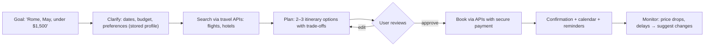

::interviewer 00:00
Design an AI agent that books travel on behalf of users.

::candidate 00:05
Clarifying questions:
1. Which company are we: a travel company (like Expedia), or an AI assistant company?
2. Consumers or business travel?
3. Scope: flights and hotels, or full trips including restaurants and activities?

::interviewer
You're an AI assistant company. Consumers. Flights and hotels first.

::candidate 00:20
Plan: (1) user problem, (2) the key design question: how much autonomy, (3) agent flow and system design, (4) handling errors, (5) trust and safety, (6) rollout, (7) metrics.

**1. User problem.** Planning a trip means hours of searching across sites, comparing prices, dates and preferences, and making many decisions. Users want: "Plan a 4-day trip to Rome in May under $1,500, with a hotel near the centre, and handle the bookings."

**2. Autonomy: the key question.** Booking travel involves **money and often irreversible actions** (non-refundable fares). So I'd define autonomy levels:

| Level | Agent does | User does |
|---|---|---|
| 1. Research | Finds and compares options | Books themselves |
| **2. Plan + confirm** | Builds the itinerary and pre-fills bookings | **Approves before payment** |
| 3. Rules-based autonomy | Books automatically within user-set rules (e.g. "refundable only, under $300") | Reviews summary |
| 4. Full autonomy | Books and changes anything | Nothing |

I'd launch at **Level 2**, and allow Level 3 later for low-risk actions (e.g. rebooking a delayed flight within rules).

::interviewer
Why not full autonomy? That's the promise of agents.

::candidate 01:15
Trust is earned. Mistakes in travel are costly and stressful: wrong dates, wrong airport, non-refundable bookings. Early on, agents will make errors and users won't trust them with their credit cards. Confirmation steps let users catch mistakes and build confidence. As accuracy is proven (measured by booking error rates), we can safely expand autonomy for specific, reversible actions. It's the same principle as human assistants: you give a new assistant more freedom over time.

::candidate 01:35
**3. Agent flow and system design:**

- **Tools:** flight and hotel search APIs (partners or aggregators), booking APIs, payment (tokenized, user-authorized).
- **Memory/preferences:** seat preferences, loyalty programmes, budget style, past trips.
- **Reasoning:** the LLM plans and compares; **deterministic checks** verify facts before showing them (dates, prices, airports, total cost).

**4. Handling errors and edge cases:**
- **Price changes** between search and booking: re-confirm with the user if the price rises beyond a tolerance.
- **Partial failures** (flight booked, hotel fails): try alternatives, notify the user, and offer options; never leave them half-booked silently.
- **Ambiguity:** ask rather than guess ("Paris, France or Paris, Texas?").
- **Clear summaries** before booking: dates, times, airports, refund policy, total cost.

**5. Trust and safety:**
- Explicit **confirmation before any payment** or non-refundable action.
- **Spending limits** and fraud checks.
- Security against **prompt injection** (e.g. malicious content on a hotel website trying to instruct the agent): restrict tools, validate actions.
- Privacy: passport and payment data stored securely, minimal sharing.
- Easy cancellation and human support when things go wrong.

**6. Rollout:** start with flights + hotels on popular routes, a beta group, then expand; collect feedback on every booking.

**7. Metrics:**
- **Task completion rate:** trips successfully planned and booked.
- **Time saved** vs self-booking (user survey), number of revisions needed.
- **Booking error rate** (wrong details, unwanted bookings): target near zero.
- **Trust:** repeat usage, % of users who enable Level 3 autonomy over time, CSAT.
- **Business:** bookings per user, revenue (commissions/fees), support tickets per booking.

**Summary:** an agent that clarifies goals, searches through travel APIs, proposes itineraries, and books only after explicit user approval (with deterministic checks, careful error handling, and strong security), expanding autonomy over time as accuracy and trust are proven.

::scorecard
- **Autonomy levels** with a clear starting point and expansion path.
- **Agent architecture** with tools, memory and deterministic checks.
- **Error handling** for real-world failures (price changes, partial bookings).
- **Security awareness** (prompt injection, payments).
