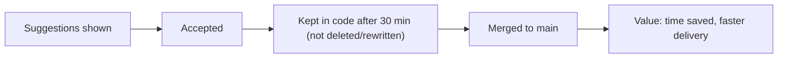

::interviewer 00:00
How would you measure the success of an AI coding assistant?

::candidate 00:05
Clarifying questions:
1. What does it do: inline code completion, chat, autonomous agents that make changes?
2. Who are the customers: individual developers or companies buying seats?
3. Is this for ongoing product health or for proving ROI to buyers?

::interviewer
Inline completions plus a chat. Sold to companies per seat. Both health and ROI matter.

::candidate 00:20
Plan: (1) the value chain from suggestion to real impact, (2) metrics at each stage, (3) North Star, (4) guardrails, (5) proving ROI to buyers.

**1. Value chain:** a suggestion only creates value if it's **shown → accepted → kept → shipped**, and saves developer time without adding bugs.

::candidate 00:40
**2. Metrics:**

| Stage | Metric | Why |
|---|---|---|
| Adoption | Weekly active developers ÷ paid seats | Seat utilization drives renewals |
| Engagement | Suggestions shown/accepted per dev per day; chat sessions | Usage depth |
| Quality | **Acceptance rate**; **retention of accepted code** (% still present after 30 min / at commit) | Accepted-then-deleted code isn't value |
| Outcome | Task completion time (controlled studies), PR cycle time, throughput | Real productivity |
| Satisfaction | Developer survey (e.g. "helps me stay in flow", "saves time") | Perceived value |
| Economics | Cost per developer (compute) vs price | Margins |

::interviewer
Isn't acceptance rate the obvious North Star?

::candidate 01:10
It's useful but misleading on its own: developers might accept a suggestion and then delete or heavily rewrite it; the model might suggest more short, trivial completions to boost acceptance; and acceptance says nothing about bugs introduced. That's why I'd look at **retained code** (accepted code still present at commit) and outcomes.

**3. North Star:** **weekly active developers who keep AI-generated code in their commits** (breadth × real value). For an ROI view, pair it with "estimated developer hours saved per seat per month".

**4. Guardrails:**
- **Code quality:** bug rate and reverts in AI-assisted code vs baseline; code review rejection rates.
- **Security:** vulnerabilities introduced (static analysis scans), secrets leaked.
- **Licensing/IP:** suggestions matching public code (filters).
- **Latency:** completions must appear within a few hundred milliseconds or developers ignore them.
- **Over-reliance:** junior developers learning (survey, code review feedback).

**5. Proving ROI to buyers (a big deal for per-seat sales):**
- Controlled studies: give similar tasks to developers with and without the assistant; measure time to completion.
- Before/after comparisons for teams that adopt it: PR cycle time, throughput (with care: other changes happen too).
- Admin dashboards for buyers: active usage, acceptance and retention, estimated hours saved, satisfaction scores.

**Summary:** measure along the value chain from suggestions to kept code to real outcomes. Use weekly developers keeping AI code as the North Star rather than raw acceptance, guard against bugs, security issues and latency, and prove ROI with controlled studies and buyer dashboards.

::scorecard
- **Value chain** from suggestion to impact.
- **Exposed the acceptance-rate trap** and chose retained code.
- **Quality and security guardrails** specific to code.
- **ROI measurement** for B2B buyers.
