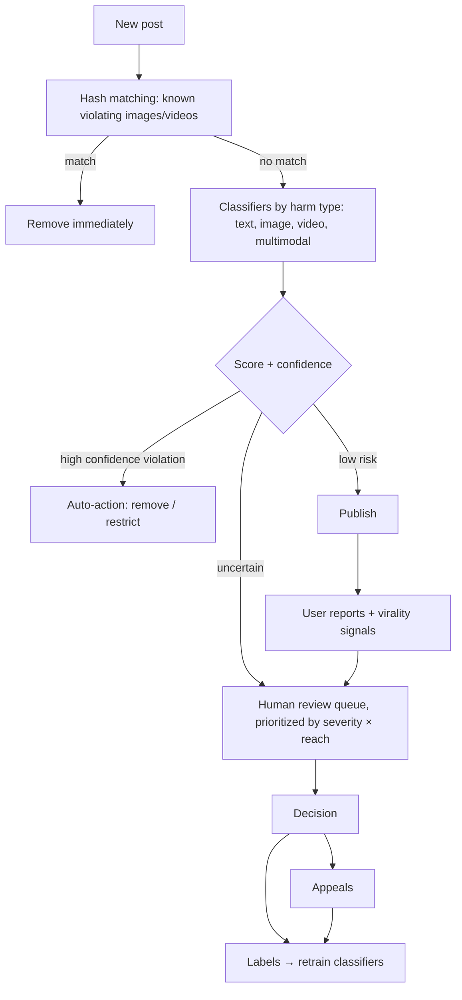

::interviewer 00:00
Design an AI content moderation system for a social platform.

::candidate 00:05
Clarifying questions:
1. What content types: text posts, images, videos, live streams, comments?
2. Scale: how much content per day?
3. Which harms matter most: spam, hate speech, nudity, violence, child safety, misinformation?
4. Any regulatory context (e.g. the EU Digital Services Act)?

::interviewer
Text, images and short videos. Hundreds of millions of posts per day. All harm types. Operating globally including the EU.

::candidate 00:25
Plan: (1) principles, (2) policy and harm tiers, (3) system design, (4) human review, (5) appeals and transparency, (6) metrics.

**1. Principles:**
- At this scale, **AI must do the first pass**; humans can't review everything.
- **Different harms need different trade-offs** between catching everything (recall) and avoiding mistakes (precision).
- **Enforcement isn't binary:** remove, reduce distribution, add a warning label, age-restrict, or leave up.
- Protect **reviewers' wellbeing** and **users' right to appeal**.

**2. Harm tiers:**

| Tier | Examples | Priority | Approach |
|---|---|---|---|
| Severe / illegal | Child sexual abuse material, terrorism, credible violent threats | **Recall above all** | Hash matching for known content, aggressive classifiers, immediate removal, report to authorities where required |
| High | Graphic violence, hate speech, harassment, self-harm content | Balanced | Classifiers + human review for uncertain cases |
| Borderline | Misinformation, sensational content, borderline nudity | **Precision** (avoid over-removal, protect speech) | Reduce distribution, labels, fact-check partners |
| Spam / scams | Fake accounts, phishing links | Recall with low friction | Behavioural signals, rate limits |

::candidate 01:15
**3. System design:**

- **Pre-publication scanning** for severe harms; **post-publication** monitoring for others, including when content suddenly goes viral.
- **Account-level signals:** new accounts, past violations, coordinated behaviour (networks of fake accounts).
- **Multilingual and cultural context:** models for many languages; local experts for context-specific hate speech and slang.

::interviewer
How do you prioritize the human review queue?

::candidate 02:15
By **expected harm**: severity of the potential violation × **predicted reach** (a post going viral needs review faster than one with 10 views) × model uncertainty. Severe categories (threats, self-harm) get dedicated fast lanes with response-time targets. Self-harm cases may also trigger support resources for the user, not just removal.

**4. Human review:**
- Specialized teams by harm type and language.
- **Reviewer wellbeing:** limit exposure to graphic content, blur by default, counselling support, rotation.
- Quality audits on reviewer decisions; consistent policy guidelines.

**5. Appeals and transparency:**
- Users get a notice explaining which rule was violated and how to appeal.
- Appeals reviewed by different reviewers; outcomes feed model training.
- **Transparency reports** with prevalence and enforcement numbers (required under the EU DSA for large platforms).

**6. Metrics:**
- **Prevalence:** % of content views that are of violating content (the best measure of user experience), sampled and labelled.
- **Proactive rate:** % of removed content found by AI before user reports.
- **Time to action**, especially for severe harms and viral content.
- **Precision:** appeal overturn rate, false positive estimates.
- **Reviewer metrics:** accuracy, wellbeing indicators.
- **Regulatory compliance:** response times to legal requests and notices.

**Summary:** an AI-first, layered system: hash matching for known severe content, harm-specific classifiers with tier-specific thresholds, graduated enforcement, human review prioritized by severity × reach, appeals that feed model improvement, and prevalence as the north-star measure, with reviewer wellbeing and transparency built in.

::scorecard
- **Harm tiers with different precision/recall trade-offs.**
- **Complete pipeline** including virality and account signals.
- **Smart queue prioritization** (severity × reach × uncertainty).
- **Appeals, wellbeing, regulation** and the right metric (prevalence).
