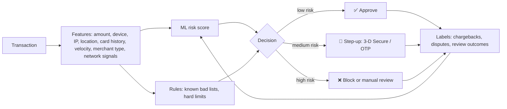

::interviewer 00:00
Design a fraud detection system for a payments product. How would you set the trade-offs?

::candidate 00:05
Clarifying questions:
1. What kind of payments: card payments for online merchants (like Stripe), P2P transfers, or a marketplace?
2. Who bears fraud losses: us, merchants, or card issuers?
3. Current fraud rate and false decline rate?

::interviewer
Online card payments for merchants. Merchants bear chargeback losses but blame us if fraud is high, and they lose sales if we block good customers.

::candidate 00:25
Plan: (1) the costs of both error types, (2) system design, (3) decisions with three outcomes, (4) setting thresholds based on economics, (5) feedback loops and adversaries, (6) metrics.

**1. Two kinds of errors:**
- **False negative (missed fraud):** chargeback losses, fees, damaged merchant trust, card network penalties if fraud rates exceed thresholds.
- **False positive (blocking a legitimate customer):** lost sale, angry customer who may never return. Industry analyses suggest **false declines often cost merchants more** than fraud itself.
So the goal isn't "catch all fraud"; it's **minimize the total cost** of both errors plus customer friction.

::candidate 00:55
**2. System design:**

- **Features:** device fingerprint, IP and geolocation mismatch, transaction velocity (many attempts in minutes), card testing patterns (small amounts across many cards), customer history, merchant category.
- **Network effect:** a payment processor sees patterns across many merchants (a card used fraudulently at one merchant can be flagged at others).
- **ML model + rules:** the model handles complex patterns; rules handle known cases and regulatory requirements.

**3. Three outcomes instead of two.** A **step-up challenge** (e.g. 3-D Secure, where the bank verifies the customer) for medium-risk transactions adds friction only where needed: genuine customers pass, fraudsters usually fail. This dramatically reduces both error types compared with approve/block only.

::interviewer
How would you choose the thresholds?

::candidate 02:00
Using **expected cost**:
- For each risk score band, estimate: probability of fraud × cost of fraud (amount + fees) vs probability of legitimate × cost of declining (lost margin + customer lifetime value) vs cost of step-up (some abandonment).
- Choose thresholds that minimize total expected cost.
- **Let merchants adjust** risk appetite: a luxury goods merchant (high fraud cost) may prefer stricter settings than a low-price digital goods merchant.
- Different thresholds by context: first-time customers vs returning, high-value vs low-value orders.
- Revisit thresholds regularly as fraud patterns and costs change.

**5. Feedback loops and adversaries:**
- **Label delay:** chargebacks arrive weeks later, so use faster signals too (manual review outcomes, customer confirmations).
- **Adversarial drift:** fraudsters adapt; monitor model performance weekly, retrain often, run anomaly detection for new patterns.
- **Selection bias:** blocked transactions never get labels; keep a tiny random holdout of approvals (with limits) or use step-up outcomes to learn.

**6. Metrics:**
- **Fraud rate** (basis points of volume) and chargeback rate (stay well below card network thresholds).
- **False decline rate** (estimated via holdouts, customer complaints, retries succeeding elsewhere).
- **Approval rate** and authorization rate.
- Step-up rate and completion rate.
- Merchant satisfaction and churn.

**Summary:** minimize the total cost of fraud plus false declines, not just fraud. Combine ML risk scores with rules and network signals, use three outcomes (approve, step-up, block), set thresholds by expected cost with merchant-adjustable risk appetite, and continuously retrain against adapting fraudsters and delayed labels.

::scorecard
- **Framed the problem as total cost** of both error types.
- **Three-outcome design** (step-up), a key insight.
- **Threshold-setting by expected cost** with context-specific settings.
- **Adversarial and label-delay awareness.**
