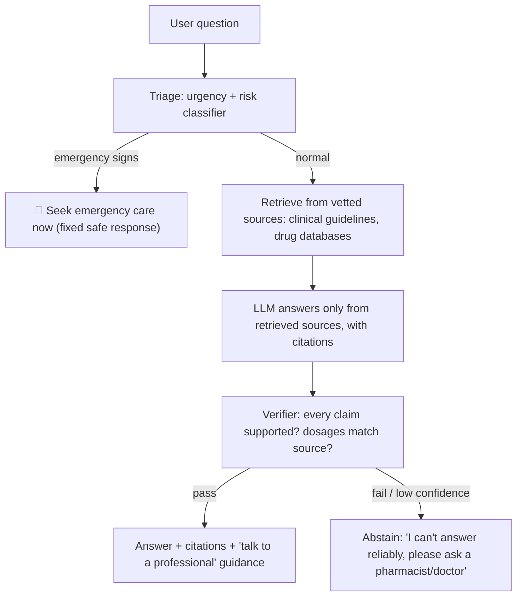

::interviewer 00:00
How would you reduce hallucinations in an AI product used for medical or legal information?

::candidate 00:05
Clarifying questions:
1. Who are the users: consumers, or professionals (doctors, lawyers)?
2. What's the use case: answering questions, summarizing documents, drafting?
3. Regulatory context: is this a regulated medical device or legal service?

::interviewer
Let's say a consumer health information assistant: people ask questions about symptoms, medications and conditions. Not a diagnostic device.

::candidate 00:25
This is high stakes: wrong information could cause harm. So I'd design **defence in depth**: several layers, because no single technique eliminates hallucinations.

Plan: (1) define what "hallucination" and "harm" mean here, (2) layered technical mitigations, (3) product/UX design for uncertainty, (4) evaluation and monitoring, (5) scope limits and escalation.

**1. Definitions:**
- **Hallucination:** a confident statement not supported by reliable sources (e.g. a wrong dosage, an invented drug interaction).
- **Harm categories:** dangerous advice (dosages, stopping medication), missed urgency (not telling someone with chest pain to seek emergency care), misinformation, privacy.

::candidate 00:55
**2. Technical layers:**

- **Grounding with retrieval (RAG):** answer only from a curated set of authoritative, up-to-date sources (clinical guidelines, official drug information), not from the model's memory.
- **Citations:** each claim links to the source passage so users (and reviewers) can verify.
- **Verification step:** a second model or rules check that each claim is supported by the retrieved text; **exact-match checks for high-risk facts** like dosages and contraindications against structured databases.
- **Abstention:** when sources don't cover the question or confidence is low, say so clearly instead of guessing.
- **Triage for urgency:** detect emergency symptoms and return a fixed, safe response directing people to emergency services, never left to free-form generation.

::interviewer
Doesn't abstaining a lot make the product useless?

::candidate 01:50
It's a trade-off I'd manage explicitly. I'd track the **abstention rate** alongside accuracy. If abstention is too high, the fix is **better coverage of sources** and better retrieval, not lowering the safety bar. For a health product, "I don't know, here's who can help" is far better than a confident wrong answer. I'd also make abstentions helpful: suggest what kind of professional to ask, related reliable articles, or questions to bring to a doctor.

**3. UX for uncertainty:**
- Clear framing: general information, not a diagnosis.
- Show sources and dates; make "consult a professional" specific and actionable.
- Avoid overly confident language for uncertain topics.
- Easy reporting of wrong answers ("This seems wrong").

**4. Evaluation and monitoring:**
- **Golden dataset** of questions created with clinicians, including tricky and adversarial ones (e.g. leading questions, rare drug combinations).
- **Metrics:** unsupported-claim rate, citation accuracy, dosage error rate (target zero), correct urgency triage (recall for emergencies must be very high), abstention rate, clinician quality ratings.
- **Expert review** of a random sample of live conversations every week.
- **Red-teaming** before each model change; regression tests to prevent backsliding.
- Monitor user reports and act on them quickly.

**5. Scope limits and escalation:**
- Out of scope: personal dosing changes, diagnosing, stopping prescribed medication → direct to professionals.
- Partnerships: "talk to a pharmacist" or telehealth handoff options.

**Summary:** use defence in depth: urgency triage with fixed safe responses, retrieval from vetted sources with citations, claim verification and exact checks for dosages, abstention when uncertain, UX that communicates limits, and rigorous clinician-built evals and monitoring, accepting some abstentions rather than risking harmful errors.

::scorecard
- **Defined harm categories** specific to the domain.
- **Layered mitigations** (RAG, citations, verification, abstention, triage).
- **Handled the usefulness vs safety trade-off** explicitly.
- **Expert-built evaluation** with the right metrics (emergency recall, dosage errors).
