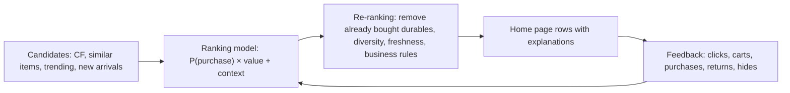

::interviewer 00:00
How would you improve and measure a recommendation system for an e-commerce home page?

::candidate 00:05
Clarifying questions:
1. What's the business goal of the home page: revenue, discovery of new products, or retention?
2. Current approach: popularity, collaborative filtering, a deep learning model?
3. Any known problems (e.g. repetitive recommendations, poor results for new users)?

::interviewer
Goal: revenue and long-term customer engagement. A basic collaborative filtering model today. Complaints: recommendations are repetitive (showing items people already bought) and new users see generic items.

::candidate 00:30
Plan: (1) define the objective properly, (2) diagnose current problems, (3) improvements, (4) evaluation (offline + online), (5) guardrails.

**1. Objective.** Optimizing for **clicks** alone leads to clickbait and low-value items. I'd optimize for a combination of **purchases (or add-to-cart), revenue, and long-term return visits**, while maintaining diversity. In practice: rank by predicted probability of purchase × value, with constraints.

**2. Diagnose the problems:**
- **Repetitive / already purchased items:** the model doesn't distinguish "viewed" from "bought". For durable goods (a TV), buying it means you won't buy another; for consumables (coffee), repurchase is good.
- **New users (cold start):** collaborative filtering needs history.
- Also likely: **popularity bias** (same bestsellers for everyone), no **context** (season, time, device).

::candidate 01:05
**3. Improvements:**

- **Purchase-aware filtering:** remove recently purchased durable items; boost **complementary** items instead (bought a camera → memory cards, bags). Allow repurchase for consumables at the right interval (coffee every ~3 weeks).
- **Cold start:** for new users, use context (traffic source, location, device, season), quick onboarding preferences ("what are you shopping for?"), popular items in relevant categories, and adapt fast with in-session behaviour (what they click right now).
- **Better signals:** add-to-cart, purchases and dwell time > clicks; returns and "not interested" as negative signals.
- **Diversity and exploration:** re-rank to avoid 10 near-identical items; include some exploration of new categories and products.
- **Context:** seasonality, time of day, device, upcoming holidays.
- **Explanations:** "Because you bought X", which builds trust and helps users understand rows.

::interviewer
How would you know the new system is better?

::candidate 02:00
**Offline evaluation** first (fast iteration on historical data):
- Precision@k / recall@k: do top recommendations include items the user later bought?
- NDCG: are relevant items ranked higher?
- Coverage: how much of the catalogue gets recommended (avoid popularity bias)?
- Diversity metrics.
Offline metrics are imperfect (they're biased toward what the old system showed), so they're a filter, not the decision.

**Online A/B test** (the real decision):
- **Primary:** revenue per visitor (or purchase conversion) from the home page.
- **Secondary:** click-through on recommendations, add-to-cart rate, new-user conversion, **7- and 30-day return visit rate** (long-term engagement).
- **Guardrails:** return rate on recommended items (relevance quality), page latency, catalogue/seller coverage (fairness for marketplace sellers), "not interested" rate.
- Run 2+ weeks for weekly cycles; check novelty effects; segment by new vs returning users.

**Summary:** shift the objective from clicks to purchases and long-term engagement; fix repetition with purchase-aware filtering and complementary items; solve cold start with context and fast in-session learning; add diversity and explanations; then evaluate offline as a filter and decide with an A/B test on revenue per visitor and return visits, with return-rate and coverage guardrails.

::scorecard
- **Objective definition** beyond clicks.
- **Diagnosis of specific problems** (durables vs consumables, cold start).
- **Architecture** (candidates → ranking → re-ranking) with a diagram.
- **Offline vs online evaluation**, with awareness of offline bias.
