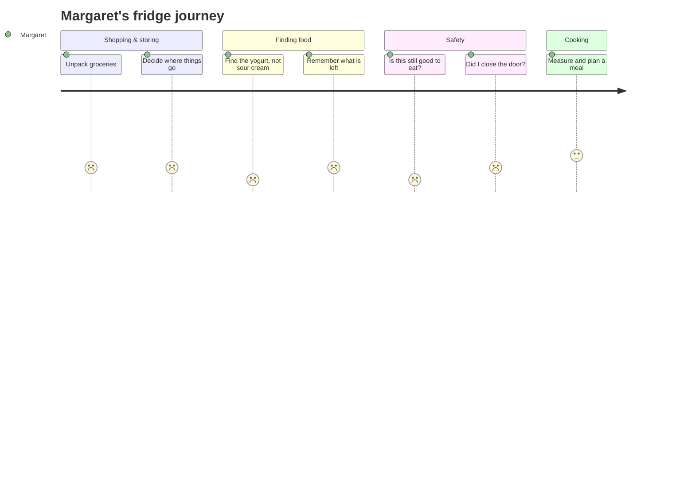

::interviewer 00:00
Let's do a product design question. Design a refrigerator for blind people.

::candidate 00:10
Great question. Do you mind if I take about 30 seconds to collect my thoughts before I start?

::interviewer
Sure, go ahead.

::coach
Asking for a pause is always fine. It prevents the most common failure: jumping straight to "a fridge that talks". Use the time to jot down your plan: *clarify → goal → users → needs → prioritize → solutions → trade-offs → recommend + metrics*.

::candidate 00:45
Thanks. First, I'd like to ask a few clarifying questions so I design the right thing.

1. **Who are "we"?** Am I a PM at an existing appliance maker, say Samsung or Whirlpool, or a startup?
2. **What's the goal?** Is this a business bet to win a new market, or more of a mission and brand play around accessibility?
3. **Do you mean fully blind, or also people with low vision?** There are many more people with low vision than with total blindness, and their needs differ.
4. **Any constraints?** Price point, timeline, or whether it has to be a whole new fridge rather than an add-on?

::interviewer
Good questions. You're a PM at a large appliance company. The goal is up to you, but leadership wants something that could ship within 18 months. Include low vision if you think it matters. No hard price constraint, but it shouldn't be a luxury toy.

::candidate 01:40
Got it. So I'll **set the goal** as this: *help blind and low-vision people manage their food independently and safely*. That's the user outcome. The business outcome is building brand trust and a credible accessible-appliance line, plus a "curb-cut" benefit: features that help blind users often help everyone (elderly people, people with their hands full).

Because of that, I'll target a price close to a normal mid-range fridge rather than a premium one. Unemployment is much higher among blind people, so affordability matters.

Here's how I'll structure the rest: **users → their journey and needs → prioritize one or two needs → brainstorm solutions → evaluate → recommend an MVP and metrics.** Does that work for you?

::interviewer
Sounds good.

::coach
Notice three things: (1) the candidate *set* a goal when the interviewer said "up to you", (2) it covers both user value and business value, and (3) the plan is announced and agreed. That's the "signposting" habit interviewers reward under structured thinking.

::candidate 02:30
**Users.** I'd segment by how people lost or are losing their sight, because that drives their coping skills and needs, more than age or income alone:

| Segment | Description | Coping skills today |
|---|---|---|
| A. Blind from birth or childhood | Uses Braille, a cane, fixed routines | Strong: sophisticated systems |
| B. **Recently lost sight** (diabetes, macular degeneration, glaucoma, accident) | Often 50+, learning to adapt | **Weak: no systems yet** |
| C. Low vision | Can see light, contrast, large shapes | Moderate: relies on what sight is left |
| D. Households with a blind member | Shared fridge with sighted family | Depends on household |

I'll focus on **segment B, people who recently lost their sight**. Three reasons:

- **Size and growth:** age-related eye disease is the biggest driver of new vision loss, and populations are ageing.
- **Pain:** they don't have the coping systems people blind from birth have built over decades, so the gap is largest.
- **Overlap:** solutions for them usually help low-vision users (C) too.

I'm giving up segment A, which is underserved in other ways, but they've often built workarounds already.

::interviewer
OK, makes sense. Go on.

::candidate 03:40
**Journey.** Let me walk through a day for a persona. **Margaret, 67**, lost most of her sight to macular degeneration two years ago and lives alone.

Pain points along the way:

1. **Identification:** many containers feel the same. Yogurt vs sour cream, two sauce jars, different leftovers in identical boxes.
2. **Freshness and expiry:** she can't read dates or see mould. *This is a food safety issue.* She either throws food away too early (waste, cost) or eats spoiled food (illness).
3. **Location:** when someone else, such as a visiting family member, rearranges things, her mental map breaks.
4. **Inventory:** knowing what she's running low on when making a shopping list.
5. **Door ajar / temperature:** she won't notice the door's open until food has warmed up.

::coach
The journey turns a generic list into *believable* needs. The interviewer can "see" Margaret. Notice the candidate flags which pain is a **safety** issue. Severity is a strong prioritization lever.

::candidate 05:10
**Prioritize.** I'll rank them on frequency, severity, and how badly current solutions fail:

| Need | Frequency | Severity | Served today? | Priority |
|---|---|---|---|---|
| Freshness / expiry | Daily | **High (health)** | Poorly: needs a sighted helper | ⭐ 1 |
| Identification | Daily | Medium | Partially: rubber bands, Braille labels | ⭐ 2 |
| Location | Weekly | Medium | OK with routines | 3 |
| Inventory | Weekly | Low | Phone lists | 4 |
| Door ajar | Occasional | Medium | Many fridges already beep | 5 |

**Freshness and identification are closely linked.** If I know *what* an item is, I can also know *when* it expires. So I'll solve them together: **"What is this, and is it still good?"**

::interviewer
Interesting. Why not just use a smartphone app with the camera? Apps like Be My Eyes already exist.

::candidate 06:00
Good push. Phone apps are genuinely useful, and I'd partner with or integrate them rather than ignore them. But they have gaps for *this* job: you need a free hand (hard when holding a container), the camera has to be aimed correctly, labels are often curved or hidden, and **expiry dates on leftovers don't exist at all**. Leftovers are exactly where food safety risk is highest. The phone helps with identifying packaged goods; it doesn't solve "when did I cook this?" So there's still a gap worth solving in the fridge itself.

::coach
The interviewer is testing whether you know the competitive landscape and can defend your choice without getting defensive. "Good push" + acknowledge + explain the specific gap = excellent handling.

::candidate 06:50
**Solutions.** Let me brainstorm a range, from low-tech to ambitious:

1. **Talking tags (low-tech + IoT):** reusable clip-on or magnetic tags. When storing food, you hold the tag near the fridge's reader and say "chicken soup, cooked today". The fridge records it and works out expiry with food-safety defaults (soup ≈ 4 days). Tap the tag later and it speaks: "Chicken soup, cooked Monday, good until Friday."
2. **Smart camera + AI fridge:** interior cameras plus a vision model identify items and read printed dates. Voice queries: "Do I have milk? Is anything expiring?"
3. **Tactile, zoned interior:** each shelf has a distinct texture and a clicking detent. Drawers have raised icons. High-contrast colours for low vision. Good universal design.
4. **Smart containers:** containers with weight sensors and NFC that know what's inside and how much is left.
5. **Morning briefing:** a daily voice summary from the fridge or a smart speaker: "Two items expire tomorrow: milk and leftover pasta."
6. **Moonshot: a spoilage "nose":** gas sensors (ethylene, ammonia) that detect spoilage directly, even without labels.

::candidate 08:10
**Evaluate.** I'll compare the top four on impact for Margaret, cost and complexity, and risk:

| Option | Impact | Cost / effort | Risk | Notes |
|---|---|---|---|---|
| Talking tags + briefing | High | **Low**, can ship in 18 months | Low | Needs a 5-second habit when storing |
| Camera + AI | High | High | **Medium–high**: misreading a date is dangerous; misses hidden items | Great as a later premium tier |
| Tactile zones | Medium | Low | None | Should be standard in all models |
| Spoilage sensor | Very high if it works | Very high, R&D | Unproven accuracy | Research bet |

The key trade-off: **reliability vs automation.** For a food safety feature, a wrong answer is worse than no answer. Talking tags are a little more manual, but they're *deterministic*: what you recorded is what you hear back. The camera is magical when it works, but an AI saying "fine until Friday" when it's not is a real health risk for this user.

::interviewer
So what would you build?

::candidate 09:20
**Recommendation: the "Know Your Food" fridge.**

**V1 (18 months):**
- **Tactile, high-contrast interior** (shelves, drawers, raised icons) as standard.
- **Talking tags** (a pack of 20 included, cheap refills) with an NFC reader at the door and voice input. Default expiry estimates by food type, which the user can change.
- **Morning briefing + voice queries** through the fridge speaker and phone app ("What's expiring?").
- **Accessible alerts:** a spoken door-ajar alert and a temperature warning.
- **Phone integration:** the companion app works with VoiceOver and TalkBack, and shared household access lets a family member check in.

**V2:** camera-based identification for packaged goods as an *assist* ("this looks like Greek yogurt"), not as the source of truth for expiry. Explore the spoilage sensor with an R&D partner.

**How I'd de-risk it before building:** interview 15–20 users through organizations like the National Federation of the Blind or RNIB, then run a **concierge test**: give 10 people existing NFC stickers and a phone app wired up to simulate the experience for 4 weeks. Do they keep tagging food? That habit is my riskiest assumption.

::candidate 10:30
**Metrics.**
- **North Star:** % of tagged items consumed or deliberately discarded *before* expiry. This captures the safety and waste outcome.
- **Adoption:** % of households actively tagging weekly after 30 and 90 days (is the habit sticking?).
- **Satisfaction:** NPS and "I feel confident my food is safe" survey scores among blind users.
- **Business:** sales of the accessible line, plus PR and brand trust lift.
- **Guardrails:** **zero** reports of a wrong "safe" reading, plus tag-reading failure rate and support calls.

**Risks:** users not building the tagging habit (mitigated with voice-first, 5-second input), and stigma ("I don't want a 'blind fridge'"). That's why I'd market it as a premium-feeling smart fridge with accessibility at its core, not as a medical device.

::candidate 11:20
**To summarize:** I focused on people who recently lost their sight, whose biggest unmet need is knowing what food they have and whether it's safe. I recommend a fridge with a tactile interior, talking tags and a daily briefing. It's reliable, affordable and shippable in 18 months, with camera AI later. Success means fewer spoiled-food incidents and less waste, measured by items used before expiry, with zero false "safe" readings as a guardrail. Happy to go deeper on any part: pricing, the go-to-market, or how sighted family members fit in.

::interviewer
Nice. One follow-up: how would you price it?

::candidate 11:55
I'd keep the base fridge within about 10–15% of a comparable mid-range model, so accessibility doesn't carry a heavy premium. Tags and the briefing are cheap to make, and I'd sell refill tags at cost. I'd also explore partnerships with vision-loss charities, some government disability programmes, and insurers that cover assistive devices. Because the features also appeal to older sighted buyers, like the briefing and tactile drawers, the volume helps keep costs down. That's the curb-cut effect working in our favour commercially.

::scorecard
- **Structure (Strong):** asked for a pause, clarified, set a goal, announced a plan, signposted every step, summarized at the end.
- **User empathy (Strong):** segmented by *how sight was lost* (a needs-based split) with explicit criteria, and created a vivid persona with a journey.
- **Prioritization (Strong):** a frequency × severity × "served today?" table. Combined two related needs into one job.
- **Product judgement (Strong):** six solutions with range, compared in a table, and made a call based on a clearly stated trade-off (reliability vs automation for a safety feature).
- **Handling pushback (Strong):** acknowledged phone apps and explained the specific gap (leftovers).
- **Business + metrics (Strong):** North Star tied to the outcome, a safety guardrail, a de-risking experiment, pricing and the curb-cut effect.
