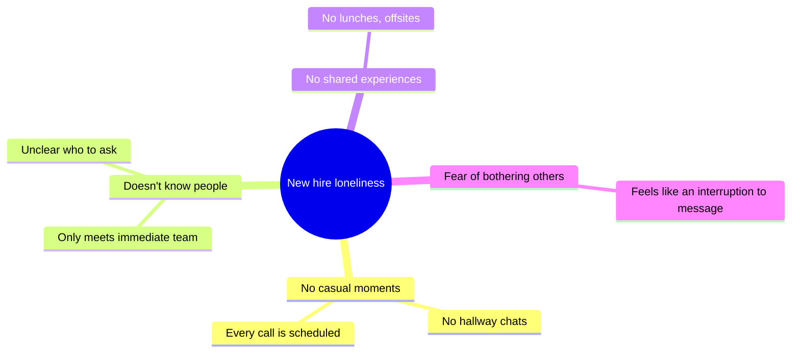

::interviewer 00:00
Design a product to reduce loneliness among remote workers.

::candidate 00:06
That's an important problem. Clarifying questions:
1. Loneliness at work (with colleagues) or in life generally (community)?
2. Are we building for employers (B2B, like Slack or Teams) or for consumers directly?
3. Any company context?

::interviewer
You're at Microsoft, Teams. Loneliness at work. B2B.

::candidate 00:30
**Goal:** help remote employees build genuine connections with colleagues. For customers (employers), that means higher engagement, better collaboration and lower attrition. For Microsoft, it differentiates Teams and supports its employee-experience products.

Loneliness is fuzzy, so I'll also define how to measure it. Plan: segments → root causes → prioritize → solutions → recommendation → metrics.

::candidate 01:00
**Segments:**
- **New hires who joined remotely**: no existing relationships, don't know the unwritten rules.
- Long-tenured remote workers: have relationships, but they fade.
- Managers of remote teams: responsible for team cohesion.
- Employees in a different time zone from their team: structurally isolated.

I'll focus on **remote new hires (first 6 months)**. Early attrition is costly, onboarding relationships predict retention, and they have the least social capital.

::candidate 01:40
**Root causes of loneliness for a remote new hire:**

**Persona:** Nina, joined 2 months ago as a data analyst. Knows her manager and 3 teammates from standups. Has never had a non-work conversation. Feels awkward messaging people "just to chat." Considering leaving: "I don't feel part of anything."

**Prioritize:** (1) **casual, low-pressure interactions** and (2) **meeting people beyond the immediate team (weak ties)**. These are what offices provided for free, and remote work removed.

::interviewer
Companies tried virtual happy hours and people hated them. Why would this work?

::candidate 02:25
Virtual happy hours failed because they're **big, forced, after hours, and on video**, which is exhausting. What research and experience suggest works is **small (2–4 people), short, during work hours, structured with a light purpose, and opt-in**. So the design principles: small groups, a purpose or prompt, during the workday, low commitment, opt-out anytime.

::coach
Use failed past attempts to derive principles. It shows learning and makes your solution more credible.

::candidate 03:00
**Solutions:**
1. **New-hire cohorts:** everyone starting the same month joins a cohort chat + a biweekly 30-minute "cohort circle" with prompts. Peers going through the same thing.
2. **Smart coffee pairings:** weekly 15-minute pairings with someone in an adjacent team or with shared interests (from profiles), auto-scheduled in free calendar slots, with conversation starters. Opt-in.
3. **Onboarding buddy:** a tenured person outside the immediate team, with guided activities ("Introduce Nina to 3 people").
4. **Ambient co-working rooms:** drop-in "focus together" audio rooms with cameras optional.
5. **Interest communities:** channels for hobbies (running, cooking) with light activities like challenges.
6. **Local meetups:** connects employees in the same city for occasional in-person lunches, with a stipend.

::candidate 03:45
**Evaluate:**

| Solution | Casual interaction | Weak ties | Effort | Adoption risk |
|---|---|---|---|---|
| Cohorts | ✅✅ | ✅✅ | Low | Low (structured) |
| Coffee pairings | ✅ | ✅✅ | Low | Medium (fatigue) |
| Buddy | ✅ | ✅ | Low (HR programme) | Depends on buddy quality |
| Co-working rooms | ✅✅ | ✅ | Medium | Medium |
| Interest communities | ✅ | ✅✅ | Low | Low |
| Local meetups | ✅✅✅ | ✅ | Medium | Geography-dependent |

**Recommendation: a "Belonging" app in Teams for onboarding:**
- Automatic new-hire cohorts with biweekly prompted circles.
- Smart pairings (2 per month by default, adjustable) with adjacent teams and shared interests.
- A buddy programme toolkit for HR.
- **Insights for HR/managers:** aggregate, anonymized "connection health" (no individual surveillance).

**Metrics:**
- **Connection:** number of distinct colleagues outside the immediate team a new hire has had a 1:1 interaction with by day 90 (weak-tie count).
- **Belonging:** a quarterly 3-question belonging survey (validated scale).
- **Outcome:** 6- and 12-month new-hire attrition vs a control group (pilot at customers).
- **Engagement:** pairing acceptance and attendance, cohort participation.
- **Guardrails:** meeting load added, opt-out rate, privacy concerns (no individual tracking shown to managers).

**Summary:** For remote new hires, loneliness comes from missing casual interactions and weak ties. Small, prompted, in-hours connection (cohorts, pairings, buddies), built into Teams, measured by weak-tie counts, belonging scores and attrition, delivers it, without the fatigue of forced social events.

::scorecard
- **Turned a fuzzy goal into measurable proxies** (weak ties + validated survey + attrition).
- **Learned from past failures** to set design principles.
- **Privacy-aware B2B insights.**
