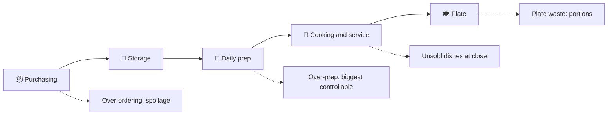

::interviewer 00:00
Design a product to help restaurants reduce food waste.

::candidate 00:06
Good one. Clarifying questions:
1. What company are we? A point-of-sale company like Toast, a delivery app, or a startup?
2. Which restaurants: independents, chains, quick-service?
3. Goal: save restaurants money, sustainability, or a new revenue line for us?

::interviewer
You're at Toast, the restaurant POS company. Pick the segment. The goal is a paid add-on that restaurants love.

::candidate 00:35
Being Toast matters: we already have **every sale, item by item, time-stamped**, plus menus and often inventory. That data is our unfair advantage.

**Goal:** a paid add-on that measurably cuts food cost through less waste, so restaurants see clear ROI. Plan: segments → where waste happens → prioritize → solutions → recommendation → ROI and metrics.

::candidate 01:00
**Segments:**
- Independent full-service restaurants: owners wear many hats, no analysts.
- **Small multi-location groups (2–20 locations):** meaningful volume, standardizable processes, a GM per location but no data team.
- Quick-service chains: often have corporate systems.
- Bakeries and cafés: high perishability.

I'll focus on **small multi-location groups**. Food cost is a large share of revenue, margins are thin (often single digits), and they're big enough that a few percent saved is real money, while being too small to build their own forecasting.

::candidate 01:40
**Where waste happens:**

**The kitchen manager's morning:** decides "how many portions of short rib, how much guacamole" based on gut feel and what happened last week. Overestimate → binned at close. Underestimate → menu items run out (lost sales, unhappy guests).

**Prioritize:** prep waste is (a) daily, (b) controllable, (c) where *our sales data uniquely helps*. Purchasing waste is linked (prep drives orders), so fixing prep helps both.

::interviewer
Isn't this just a forecasting model? What's the product?

::candidate 02:30
The model is the engine, but the product is **getting a busy kitchen to change its behaviour**. That means: (1) output in the form they already use, a **prep list** by station, in portions, not "predicted sales"; (2) explaining why ("Big game tonight, +30% wings"); (3) the chef can adjust and the system learns; (4) closing the loop by measuring waste. Without workflow fit, a perfect model sits unused.

::coach
"Isn't this just ML?" Great answer: the product is about behaviour change and workflow, not the model. Interviewers love hearing that a model alone isn't a product.

::candidate 03:10
**Solutions:**
1. **Smart prep list:** each morning, the tablet shows per-station prep quantities: forecast of each dish × recipe → ingredient prep. Inputs: POS history, day of week, weather, holidays, local events, reservations.
2. **10-second waste logging:** at close or when binning, tap item + reason (overprep, spoiled, returned) on a kitchen tablet, or use a scale integration.
3. **Smart ordering suggestions** for supplier orders based on forecast and stock on hand.
4. **End-of-day surplus:** list unsold food on Too Good To Go or similar, or donate via partners.
5. **Weekly "money saved" report** per location for owners, comparing locations.

**Evaluate:** the prep list has the highest ROI and the strongest data advantage; waste logging is needed to prove ROI and improve the model; ordering is next; surplus recovers some revenue but doesn't prevent waste.

::candidate 04:00
**Recommendation: "Toast Prep" add-on.**
- Morning prep list per station, with explanations and the ability to override (the overrides train the model).
- Waste logging at close (tablet or scale).
- Owner dashboard: food cost %, waste $ by item and location, forecast accuracy.
- Price: ~$100/location/month, justified by ROI.

**ROI story:** a $2M/year location with 30% food cost spends $600k on food. If prep waste is ~5% of food purchases, that's $30k. Cutting it by 40% saves about $12k a year, roughly 10× the price.

**Metrics:**
- **North Star:** waste $ per $1,000 of sales, per location.
- Food cost % change vs before adoption; prep list usage (% of days used); forecast accuracy (MAPE).
- **Guardrails:** "86'd" (out of stock) events and lost sales from under-prep; staff time spent on logging.
- **Business:** add-on attach rate, churn, NPS.

**Summary:** For small restaurant groups, over-prep is the biggest controllable waste. Toast's sales data can power a station-level prep list that fits the kitchen workflow, with quick waste logging to close the loop. A clear ~10× ROI drives adoption.

::scorecard
- **Leveraged the company's data advantage** explicitly.
- **Workflow and behaviour change** emphasized over the model.
- **Quantified ROI** for a B2B buyer, plus a guardrail against under-prep.
