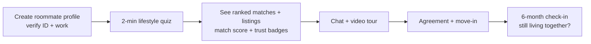

::interviewer 00:00
Design a product that helps people find roommates.

::candidate 00:06
Sure. Let me ask a few clarifying questions first.
1. Is this a standalone startup, or a feature inside an existing platform like Facebook or Airbnb?
2. Geography: one market, like the US, or global?
3. Is the user looking for a room *and* a roommate, or only a person to share with?
4. Any business goal, such as revenue now or growth first?

::interviewer
Let's say you're at Meta and this would live inside Facebook. US first. Goal: engagement and building a new marketplace use case. Both cases count: people with a room to fill and people looking for one.

::candidate 00:50
Perfect. Being inside Facebook matters: we have **identity, mutual friends, groups and Marketplace**, which are strong assets for trust.

**Goal:** help people find a compatible, trustworthy roommate quickly, measured ultimately by successful living arrangements, while growing a new marketplace category for Facebook.

**Plan:** marketplace sides → focus segment → journey and pains → prioritize → solutions → evaluate → MVP + metrics. Sound OK?

::interviewer
Yes.

::candidate 01:20
**This is a two-sided marketplace:**
- **Room holders:** have a lease or own a place and need someone to fill a room.
- **Room seekers:** need a place and people to live with.
- (Plus some "team up" seekers: two strangers who want to find an apartment together.)

Segments of seekers:

| Segment | Pain intensity | Notes |
|---|---|---|
| Students | Medium | Universities often help; strong peer networks |
| **Young professionals relocating to a new city** | **High** | No local network, can't visit in person, high scam exposure |
| Locals whose lease is ending | Medium | Can visit and ask friends |
| Seniors home-sharing | Medium | Niche but growing |

I'll focus on **young professionals relocating** (say, ages 22–35) to expensive cities like New York or San Francisco. Highest pain, high frequency of moves, and Facebook's identity graph helps most when you don't know anyone. I'll design for both sides, but anchor on the seeker experience.

::candidate 02:25
**Journey for a relocating seeker, Priya, 26**, moving from Austin to New York for a new job:

1. **Search:** scrolls Craigslist, Facebook groups and Reddit. Listings are scattered and outdated.
2. **Contact:** messages 30 people, and 5 reply.
3. **Vet:** "Is this person real? Is the apartment real?" Scam stories everywhere: "send the deposit and I'll mail you the keys."
4. **Compatibility:** tries to judge over chat whether they're clean, quiet, or party a lot.
5. **Visit:** often impossible from another city.
6. **Commit:** pays a deposit to a stranger and signs or sublets.
7. **Live together:** conflicts about cleaning, guests, bills.

**Pains:** fragmented listings, **scams and safety**, **compatibility uncertainty**, slow responses, remote viewing, payment trust, and conflict later on.

**Room holder pains:** too many low-quality messages, no-shows, fear of letting in someone unreliable who stops paying rent.

::candidate 03:30
**Prioritize.** The two biggest are **trust** (scams, safety) and **compatibility**:
- Both are high severity: a bad roommate means months of misery, and a scam means losing $2–5k.
- Both are where existing channels fail badly (Craigslist has no identity, and chat is a poor way to judge compatibility).
- Both play to **Facebook's unfair advantage**: real identity and the social graph.

Speed and listing aggregation matter, but they're easier for competitors to copy.

::interviewer
What about privacy? People may not want roommates seeing their Facebook profile.

::candidate 04:00
Very important. I'd make the roommate profile **separate from the main profile by default**. Share *signals* instead of raw data: "Verified identity ✅", "Works at a verified company ✅", "3 mutual friends" (names shown only if both people opt in), and "Facebook member since 2014". People choose what to reveal. Trust without overexposure.

::coach
Privacy pushback is common at Meta. The answer gives a concrete design principle: *share verified signals, not raw data*. Specific beats generic ("we'll respect privacy").

::candidate 04:40
**Solutions.**
1. **Verified roommate profiles:** ID verification, workplace or school email verification, a mutual-friends signal, response rate.
2. **Compatibility matching:** a 2-minute lifestyle quiz (sleep schedule, cleanliness, guests, work from home, pets, smoking, budget, move-in date). Hard dealbreakers filter people out, soft preferences produce a match score.
3. **Live video tours + calls inside Messenger**, with tour recording for people who can't visit.
4. **Deposit protection / escrow:** held by a payments partner until move-in is confirmed.
5. **Roommate agreement template:** chores, guests, bill split, signed digitally. Reduces conflict later.
6. **References from past roommates:** short vouches.

::candidate 05:30
**Evaluate.**

| Solution | Impact on trust | Impact on compatibility | Effort | Uses FB advantage? |
|---|---|---|---|---|
| Verified profiles | ⭐⭐⭐ | ⭐ | Medium | ✅✅ |
| Compatibility matching | ⭐ | ⭐⭐⭐ | Medium | ✅ (groups, interests) |
| Video tours | ⭐⭐ | ⭐ | Low (Messenger exists) | ✅ |
| Escrow | ⭐⭐⭐ | – | High (regulation, payments) | Partial |
| Agreement template | – | ⭐⭐ | Low | – |
| References | ⭐⭐ | ⭐⭐ | Medium (cold start) | ✅ |

**Recommendation for the MVP:** **verified profiles + compatibility matching + video tours in Messenger**, launched in **2 cities** (NYC, SF). Escrow and references in v2.

**Flow:**

**Cold start:** seed supply from existing Facebook housing groups (invite group admins and posters to create verified listings), and from Marketplace rentals.

::candidate 07:00
**Metrics.**
- **North Star:** *successful matches still living together after 3 months* (measured by an opt-in check-in). Captures real value, not just messages.
- **Funnel:** profiles created → % verified → conversations started per seeker → video tours → agreements → move-ins.
- **Liquidity:** % of active seekers who get 3+ quality matches within 7 days; time to match.
- **Guardrails:** scam and fraud reports per 1,000 conversations, harassment reports, privacy complaints, holders getting spam.

**Risks:** fake listings (counter with verification, ML scam detection, payment warnings), discrimination in roommate preferences (fair-housing rules; restrict which preference filters are allowed), and a thin market at launch.

::candidate 08:10
**Summary:** For relocating young professionals, the biggest problems are trust and compatibility. Facebook's identity and social graph are uniquely suited to solve both. I'd launch verified roommate profiles, compatibility matching and Messenger video tours in two cities, measured by successful moves that last 3+ months, with scam reports as the key guardrail.

::interviewer
How would you monetize it later?

::candidate 08:30
I'd keep it free to build liquidity, then add: featured listings for room holders and property managers, a fee on the escrow and deposit service, background checks as a paid add-on for holders, and partnerships with moving and insurance companies. Facebook also benefits indirectly through engagement and Marketplace ads.

::scorecard
- **Leveraged the company's assets** (identity, graph, Messenger) with a clear "why us".
- **Two-sided thinking:** holder and seeker pains, a cold-start plan, liquidity metrics.
- **Privacy and fair-housing awareness**, answered concretely.
- **Strong North Star** tied to a real outcome (successful living arrangements).
