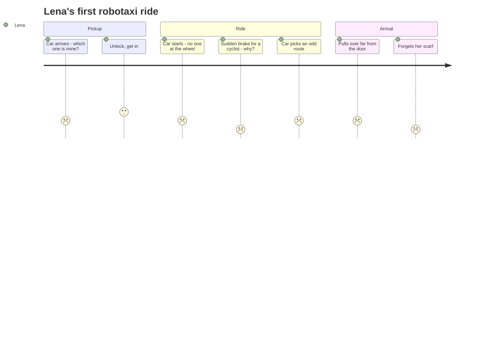

::interviewer 00:00
Design the in-car experience for a self-driving taxi.

::candidate 00:06
Interesting. Let me clarify:
1. Fully driverless, with no safety driver?
2. Which company and market? Something like Waymo in a US city?
3. Is the goal adoption by first-timers, rider satisfaction, or revenue per ride?
4. Can we change the car's hardware, or only software and screens?

::interviewer
Fully driverless, Waymo-like, in a big US city. You can influence hardware inside the cabin. Goal is your call.

::candidate 00:40
**Goal:** turn first-time riders into repeat riders. In this category, **trust** is the biggest barrier to adoption. If the first ride is scary or confusing, people won't come back.

Plan: rider segments → focus → ride journey → pains → prioritize → solutions → recommendation → metrics.

::candidate 01:05
**Segments:**
- **Curious first-timers:** tried it because of the novelty or a promo; mild anxiety.
- **Anxious first-timers:** were nervous but needed a ride; high anxiety.
- **Regular commuters:** want efficiency and productivity.
- **Riders with accessibility needs:** blind, wheelchair users. Huge potential: independence without a driver.
- **Parents with kids, late-night riders:** safety-focused.

I'll focus on **first-time riders** (both curious and anxious). Every future segment passes through a first ride, and the second-ride rate is the gateway metric for the whole business.

::candidate 01:45
**Journey of a first ride (Lena, 34, going to dinner at 8pm):**

**Pains:**
1. **"Is it safe? What is it doing?"** No driver to read or ask. Sudden behaviour feels scary.
2. **"What if something goes wrong?"** Breakdowns, a medical issue, a person approaching the car.
3. **Pickup confusion:** finding the right car at a busy curb.
4. **Lack of control:** can't say "pull over here" or "slow down".
5. **Arrival issues:** wrong drop-off spot, forgotten items.

**Prioritize:** (1) understanding and trust and (2) help when things go wrong are both high severity and decide whether there's a second ride. (4) Control is closely linked to (1). Pickup and arrival are important but secondary.

::interviewer
Riders say they feel safe after a few minutes anyway. Why invest in trust features?

::candidate 02:45
Some do, and that's encouraging. But (a) we lose the ones who don't: if 20% of first riders never return because of one scary moment, that's a big loss in a business with high fixed costs, and (b) trust features protect us in rare incidents, which shape public perception and regulation. I'd validate it with data: compare the second-ride rate of riders who experienced a hard brake against those who didn't. If the gap is big, trust features pay for themselves.

::candidate 03:20
**Solutions:**
1. **"What the car sees" view:** the rear screen shows a simplified 3D view of detected cars, cyclists and pedestrians, plus the planned path. **Explanations of actions:** "Slowing down: cyclist ahead", "Waiting for pedestrian".
2. **Advance notice:** "Stopping in 50 m for the red light", "Merging left".
3. **Control panel:** big "Pull over safely" button, "Start ride" confirmation, adjustable driving style (gentle/standard), climate, music.
4. **Instant human support:** a physical "Help" button → video call with an operator within ~10 seconds, who can see the car's state.
5. **Pickup:** the car shows the rider's initials on its roof display, honks or flashes on request, and the app gives AR walking directions to the car.
6. **Arrival:** fine-tune the drop-off spot on the map. Seat sensor + "Don't forget your items" alert. Exit-side check for approaching cyclists.
7. **Accessibility:** audio descriptions of the ride for blind riders, braille labels in the cabin.

::candidate 04:20
**Evaluate:**

| Solution | Trust impact | Effort | Notes |
|---|---|---|---|
| What the car sees + explanations | High | Medium (perception data exists) | Biggest anxiety reducer |
| Advance notice | Medium | Low | Cheap, effective |
| Pull over + controls | High (sense of control) | Medium (safety validation) | Must be safe to execute |
| Human support button | High | Medium (operations cost) | Safety net |
| Pickup identification | Medium | Low | Fixes first impressions |
| Arrival features | Medium | Low | Reduces support tickets |

**Recommendation for the first-rider experience:**
- **Before the ride:** a 30-second welcome ("I'll explain what I'm doing as we go"), seatbelt check, a "Start" button so the rider controls the departure.
- **During:** the transparency view + spoken explanations for unusual events (on by default for first rides, optional later).
- **Always available:** "Pull over safely" and "Help" buttons.
- **After:** a rating focused on safety ("Did you feel safe?") and a lost-item alert.

::candidate 05:30
**Metrics:**
- **North Star:** second-ride rate within 14 days of the first ride.
- **Trust:** post-ride "felt safe" score, especially after events like hard brakes.
- **Support:** help-button presses per 100 rides, time to connect, issue resolution.
- **Operations:** pickup time (car arrival → rider seated), drop-off accuracy.
- **Guardrails:** safety incidents, pull-over-button misuse, rider complaints.

**Summary:** For first-time riders, trust is everything. I'd make the car's behaviour understandable (transparency view and spoken explanations), give the rider control (start and pull-over buttons), and provide an instant human safety net. Success is the share of first riders who take a second ride within two weeks.

::scorecard
- **Picked the gateway segment** (first-timers) linked to the business-critical metric.
- **Pushback answered with a data test**, not opinion.
- **Comprehensive journey** including failure modes and accessibility.
