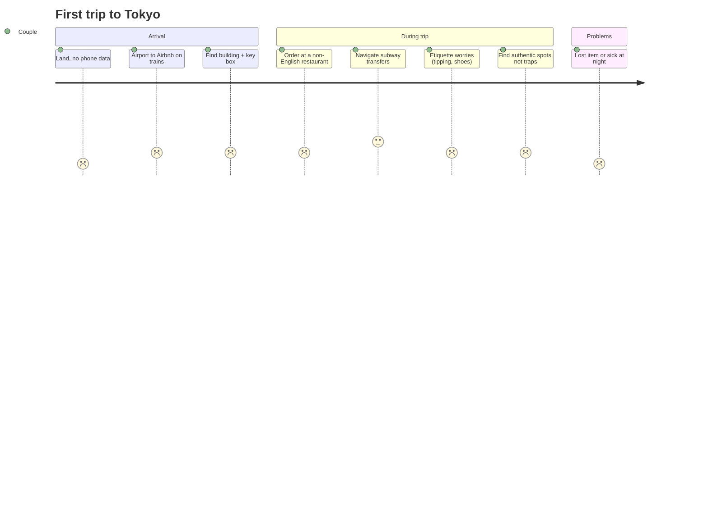

::interviewer 00:00
Design a product for travellers visiting a foreign country for the first time.

::candidate 00:06
Clarifying questions:
1. Which company are we, or is this a standalone product?
2. Before, during, or after the trip?
3. Leisure or business travellers?

::interviewer
You're at Airbnb. Pick the phase and traveller type.

::candidate 00:30
**Goal for Airbnb:** be the trusted companion for the whole trip, not just the booking, increasing trip satisfaction and rebooking. I'll focus on **leisure first-timers in a country with a language barrier**, during the trip, where anxiety and helplessness peak.

Plan: segments → journey → pains → prioritize → solutions → recommendation → metrics.

::candidate 00:55
**Segments:** solo backpackers (budget, social), **couples on a first big international trip** (excited and nervous), families (logistics heavy), business travellers (efficient, often hotels). I'll pick **couples on their first trip to a non-English-speaking country**, e.g. Americans visiting Japan. A large, high-value Airbnb segment with lots of uncertainty.

::candidate 01:20
**Journey (Sam and Jo, first time in Tokyo, staying at an Airbnb in Shibuya):**

**Pains:** no data on arrival, getting to the stay, finding the entrance, the language barrier in daily moments, etiquette anxiety, tourist traps, and emergencies.

**Prioritize:** the **first 3 hours (arrival)** and **daily language moments** are the most frequent and stressful. Arrival issues also generate many Airbnb support tickets and bad first impressions, so they're good for both the guest and the business.

::candidate 02:10
**Solutions:**
1. **Arrival kit:** an eSIM sold with the booking (data from the moment you land) + step-by-step photo directions from the airport to the door (train lines, which exit, building photo, how the key box works), written by the host using a template.
2. **Trip companion mode** (activated on arrival): offline phrase cards that change by context (restaurant, train station, pharmacy), camera menu translation, "show this to the taxi driver" address card, etiquette tips.
3. **Host's local guide:** hosts share favourite spots (ramen place, quiet temple). Authentic, trusted, already part of Airbnb's community.
4. **24/7 help with interpretation:** for emergencies (lost passport, doctor), with a live interpreter call.

::interviewer
Why wouldn't travellers just use Google Translate and Google Maps?

::candidate 02:45
They will, and we should **link out to them** rather than rebuild them. Our differentiation is **context and trust that only Airbnb has**: the host's exact arrival instructions and building photos, the host's personal recommendations, and an emergency safety net tied to the booking. Google doesn't know which key box is yours or what your host recommends. So I'd build only what's uniquely ours and integrate the rest.

::coach
Good competitive judgement: don't rebuild commodities; build what only your company can do.

::candidate 03:20
**Recommendation:**
- **V1:** arrival kit (eSIM partner + host-written photo directions template + key box instructions) and the host's local guide inside the trip view, plus an emergency help line.
- **V2:** trip companion mode with phrase cards and a translation integration.

**Metrics:**
- **North Star:** trips rated 5 stars on "arrival" + overall.
- Arrival support tickets per 1,000 check-ins (target −40%); % of hosts with complete arrival guides; eSIM attach rate (revenue); host guide engagement.
- **Long term:** rebooking rate within 12 months for first-time international guests.
- **Guardrails:** host burden (time to set up the guide), privacy, translation errors in emergencies.

**Summary:** For first-time international travellers, the most stressful moments are arrival and daily language barriers. Airbnb can uniquely solve arrival (host photo directions, an eSIM, key instructions) and provide trusted local knowledge from hosts, while integrating commodity tools like translation. Measured by arrival ratings, support tickets and rebooking.

::scorecard
- **Prioritized the highest-stress moment** with business benefit (support tickets).
- **"Build what only we can do"** competitive logic.
- **Clear phased plan** with revenue (eSIM) and community assets (hosts).
