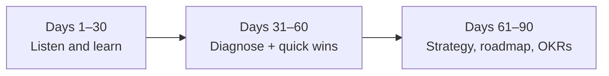

::interviewer 00:00
You just joined as the PM of a new team. What do you do in your first 90 days?

::candidate 00:05
Clarifying questions:
1. Is the team new (just formed) or existing (I'm replacing a PM)?
2. What's the product area?
3. Any urgent expectations from leadership?

::interviewer
Existing team, previous PM left. Product: the onboarding experience of a consumer fintech app. Leadership wants improved activation but hasn't set specifics.

::candidate 00:25
My plan has three phases: **Listen and learn (days 1–30)**, **Diagnose and earn trust (days 31–60)**, **Set direction (days 61–90)**.

**Days 1–30: Listen and learn**
- **People:** 1:1s with each engineer, the designer, the data analyst, my manager, and key partners (compliance, marketing, customer support, risk). Questions: what's working, what's frustrating, what would you change?
- **Users:** watch session recordings, read support tickets, talk to 10+ new users (including those who dropped off).
- **Data:** the onboarding funnel step by step, activation definition, cohort retention, experiments run by the previous PM and results.
- **Product:** go through onboarding myself on different devices; KYC/identity checks, linking a bank account, first transaction.
- **History:** previous roadmap, decisions, and why.

::interviewer
What would you look for in the data specifically?

::candidate 01:15
- **Where users drop off:** e.g. identity verification (KYC) photo upload, bank linking, first deposit.
- **Time to complete onboarding** and how many abandon and come back.
- **Segments:** device, acquisition channel, country; are some failing more?
- **Activation definition:** does "completed onboarding" actually predict retention, or does "first transaction within 7 days" predict it better? I'd check correlation with 30/90-day retention to pick the right activation metric.

::candidate 01:40
**Days 31–60: Diagnose and earn trust**
- Synthesize findings: top 3 problems with evidence (e.g. "40% drop at KYC photo upload; 60% of those are on Android with blurry photos").
- **Ship 1–2 quick wins** to build trust and momentum: e.g. better photo guidance, clearer error messages.
- **Fix team process gaps** found in 1:1s (e.g. unclear priorities, no regular user research).
- Align with compliance and risk early, since onboarding in fintech is regulated.

**Days 61–90: Set direction**
- **Strategy doc:** the problem, the target user, the activation definition, key bets (e.g. "instant bank verification", "progressive onboarding: let people explore before full KYC where regulation allows").
- **OKRs:** e.g. Objective: "Make it effortless to start using the app"; KR: activation (first transaction in 7 days) from 30% to 40%; KYC completion from 60% to 75%.
- **Roadmap:** Now / Next / Later, reviewed with the team and leadership.
- **Rituals:** weekly metrics review, monthly user research, quarterly planning.

**Things I'd avoid:** big changes in week 1, criticizing past decisions without context, or committing to dates before understanding constraints.

**Summary:** First listen and learn (people, users, data, product), then diagnose the biggest problems and ship quick wins to build trust, then set a strategy, activation OKRs and a roadmap aligned with leadership, compliance and the team.

::scorecard
- **Structured 30/60/90 plan** with concrete activities.
- **Data-driven definition of activation** (validated against retention).
- **Context awareness** (fintech compliance).
- **Trust-building through quick wins.**
