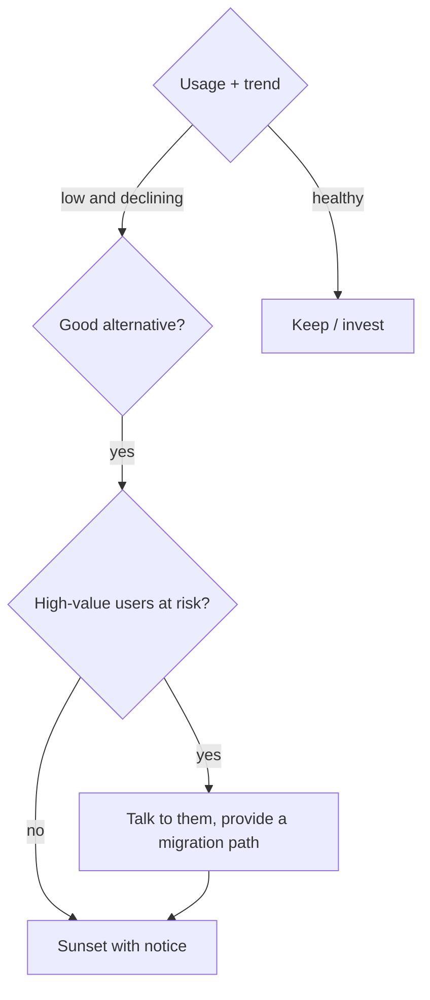

::interviewer 00:00
How would you decide whether to sunset a feature?

::candidate 00:05
Let me make it concrete. Is there a specific feature, or should I pick an example?

::interviewer
Pick an example.

::candidate 00:10
Let's say a project management tool has a **built-in chat feature** launched 3 years ago. Usage is low because most teams use Slack, and maintaining it costs engineering time.

Plan: (1) gather data on value, (2) gather data on cost, (3) strategic fit, (4) decide using a framework, (5) if sunsetting, plan the execution.

::candidate 00:25
**1. Value:**
- **Usage:** how many users and teams use chat weekly, and the trend (growing, flat, declining)?
- **Who uses it:** if it's mostly high-value enterprise accounts, removing it could cause churn.
- **Dependency:** do any workflows depend on it?
- **Satisfaction and alternatives:** do users have good alternatives (Slack, Teams integrations)?

**2. Cost:**
- Engineering time on maintenance, bugs, security updates.
- Infrastructure costs.
- **Complexity cost:** it clutters the UI and makes new features harder to build.
- Opportunity cost: what the team could build instead.

**3. Strategic fit:** is chat part of our future vision, or did the market move to integrations?

::interviewer
Say 4% of weekly users use chat, it's declining, but 3 large enterprise customers use it heavily.

::candidate 01:00
**4. Decision:**
- Declining usage, good alternatives, ongoing costs → strong case to sunset.
- But the 3 enterprise customers are a risk, so I'd **talk to them first**: understand why they use it, what they'd need to switch, and whether a strong Slack/Teams integration would cover it.

**5. Execution plan:**
- **Build the migration path:** a better Slack/Teams integration so conversations about tasks flow there; export of chat history.
- **Notice:** announce 3–6 months ahead (longer for enterprise contracts), with in-app banners and emails.
- **Help the three key accounts** with dedicated support.
- **Staged shutdown:** stop new chat creation → read-only → removal.
- **Monitor:** churn, support tickets, complaints, usage of the replacement integration.

**Summary:** Weigh value (usage, trend, who uses it) against cost (maintenance, complexity, opportunity), check strategic fit, protect high-value users with a migration path, and sunset gradually with clear communication.

::scorecard
- **Concrete example** makes the framework tangible.
- **Value vs cost vs strategy** reasoning.
- **Careful handling of high-value users** and a staged execution plan.
