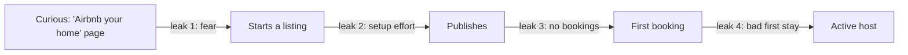

::interviewer 00:00
How would you improve Airbnb for first-time hosts?

::candidate 00:05
Clarifying questions:
1. Goal: more people becoming hosts (supply growth), or better first experiences for those who already listed?
2. Any market?
3. Type of listing: whole homes or private rooms?

::interviewer
Supply growth: converting interested people into active hosts. US. Any type.

::candidate 00:25
**Goal:** increase the number of new hosts who publish a listing and get their first booking within 30 days. Supply growth matters because guest demand in many markets is limited by available listings, and new hosts bring diverse, fresh inventory.

Plan: host funnel → leaks → why → ideas → prioritize → metrics.

::candidate 00:45
**New host funnel:**

I'd look at data for the biggest drop. Assume it's **leak 1** (curious → start) and **leak 3** (published → no bookings).

**Why they leave:**
- Leak 1: **fear**: damage, strangers in my home, legality, taxes; **uncertainty about earnings**.
- Leak 2: photos, descriptions, pricing are effortful and confusing.
- Leak 3: **no reviews → low ranking → no bookings** (the cold-start problem).
- Leak 4: a bad first guest experience.

::candidate 01:30
**Persona:** Mark, 45, has a spare room since his kid went to college. Curious about the extra income, but worried about strangers and damage, and confused about local rules.

**Ideas:**
1. **Earnings estimator + local rules check:** "Similar rooms nearby earn ~$1,200/month" + a summary of local regulations and taxes.
2. **Protection made visible:** explain host damage protection, guest ID verification and the house-rules tools up front, with real examples.
3. **AI listing builder:** upload photos → a title, description and suggested price; checklist for photo quality.
4. **First-booking boost:** new listings get a temporary visibility boost and a "New" badge; option for an introductory discount.
5. **Experienced host mentors (Superhost Ambassadors).**
6. **"First guest" filter:** prefer experienced guests with good reviews for first bookings to reduce risk.

::interviewer
Boosting new listings might give guests bad experiences. How do you balance that?

::candidate 02:20
Only boost listings that pass a **quality bar** (photo quality, complete info, responsive host), limit the boost duration (e.g. first 30 days), match the first guests carefully (experienced guests with good reviews), and monitor new-listing ratings. If a new listing's first ratings are poor, the boost stops. Guests get a fair trade-off via an introductory price.

::candidate 02:50
**Prioritize:**

| Idea | Leak addressed | Impact | Effort |
|---|---|---|---|
| Protection + verification visibility | 1 (fear) | High | Low |
| Earnings estimator + rules | 1 | High | Medium (exists partly) |
| AI listing builder | 2 | Medium | Medium |
| First-booking boost + experienced first guests | 3 + 4 | **High** | Medium |
| Mentors | 2, 4 | Medium | Low (programme) |

**Recommendation:** fear reduction at the top of the funnel (protection + verified guests + earnings/rules) and a first-booking boost with experienced first guests.

**Metrics:**
- **North Star:** new hosts with a first booking within 30 days of starting a listing.
- Funnel conversion at each leak, time to publish, % of new listings booked within 30 days, first-stay ratings, 6-month host retention.
- **Guardrails:** guest ratings of new listings, cancellations by new hosts, damage claims.

**Summary:** First-time hosts drop out because of fear and the cold start. Making protection and guest verification visible, estimating earnings, and giving quality new listings a protected first-booking boost converts more curious homeowners into active hosts.

::scorecard
- **Funnel-based structure** with leaks and causes.
- **Supply-side cold start** clearly handled.
- **Guest-side guardrails** balancing both sides of the marketplace.
