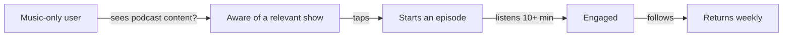

::interviewer 00:00
How would you improve podcast discovery on Spotify?

::candidate 00:05
Clarifying questions:
1. Is the goal converting music-only listeners into podcast listeners, or helping existing podcast listeners find more shows?
2. Any business context, e.g. podcast ads revenue?

::interviewer
Converting music listeners. Podcasts have better margins than music for Spotify.

::candidate 00:25
Right. Music royalties take a large share of revenue, while podcasts (especially Spotify-sold ads) have better economics. **Goal:** increase the % of music-only users who become regular podcast listeners.

Plan: funnel diagnosis → find the biggest leak → understand why → ideas → prioritize → metrics.

::candidate 00:45
**Funnel for a music-only user:**

I'd want data on each step, but my hypothesis is that the biggest leak is between **aware → start**, and **start → engaged**.

::interviewer
Assume data shows most users see podcast recommendations but very few start an episode.

::candidate 01:15
Great, so the leak is **trial**. Why? Compared with a song:
- **Commitment cost:** a song is 3 minutes; an episode is 45–90 minutes. Picking the wrong one wastes time.
- **Uncertainty:** cover art and titles say little about whether you'll like the host's style.
- **Context mismatch:** recommendations appear while the user is in "music mode".
- **Discovery shape:** podcasts are often found by word of mouth, not browsing.

So the core problem: **trying a podcast feels risky and costly**.

::candidate 01:50
**Ideas:**
1. **Podcast previews feed:** a vertical feed of 30–60 second highlight clips (auto-generated from transcripts, or host-chosen). Tap "Keep listening" to continue from that exact moment.
2. **Bridge recommendations from music taste:** "Because you listen to Taylor Swift → podcasts about songwriting and pop culture". Also artist-hosted podcasts.
3. **Short-episode starter shelf:** episodes under 20 minutes for an easy first try.
4. **Context-aware placement:** suggest podcasts at the start of the commute, or after an hour of background music.
5. **Social proof:** "Popular with listeners like you", "3 friends follow".

**Prioritize:**

| Idea | Lowers trial cost | Relevance | Effort |
|---|---|---|---|
| Previews feed | ✅✅✅ | ✅ | Medium (clip generation) |
| Music → podcast bridge | ✅ | ✅✅ | Medium |
| Short-episode shelf | ✅✅ | – | Low |
| Context placement | ✅ | ✅ | Low |

**Recommendation:** previews feed (it attacks commitment cost directly) + music-to-podcast bridging for relevance, with the short shelf as a quick win.

::interviewer
How would you choose good clips automatically?

::candidate 02:50
Use transcripts + listening data: segments where existing listeners rarely skip and often replay; detect self-contained segments (complete thoughts, strong hooks, not ads or intros). Let creators override with their own pick. Evaluate offline with human ratings of clip quality, then online by "keep listening" rate per clip.

::candidate 03:20
**Metrics:**
- **Primary:** % of music-only users who start a podcast within 30 days.
- Preview → keep-listening rate; first episode listen time (10+ minutes); follow rate; podcast 4-week retention.
- **Business:** podcast ad impressions and revenue per user.
- **Guardrails:** music listening time (shouldn't drop significantly), creator complaints about clips, skip rate on clips.

**Summary:** Music listeners see podcasts but don't try them because the commitment feels high. Short, high-quality preview clips that continue into the full episode, plus recommendations bridged from music taste, lower the trial cost. Measured by 30-day podcast start rate and retention.

::scorecard
- **Funnel diagnosis first**, then root cause (commitment cost vs a song).
- **Used the interviewer's data hint** effectively.
- **Explained an ML approach** with offline + online evaluation.
