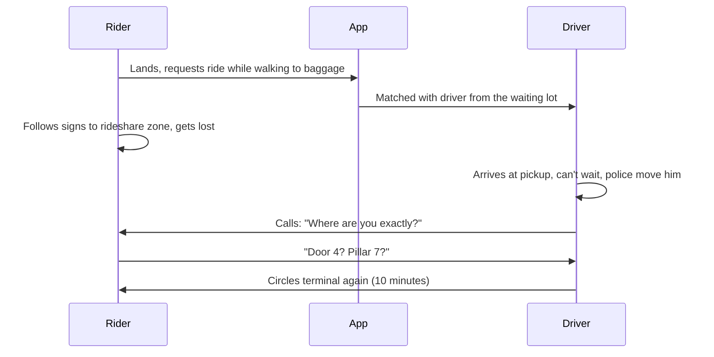

::interviewer 00:00
Improve the Uber airport pickup experience.

::candidate 00:05
Clarifying questions:
1. Rider experience, driver experience, or both?
2. Large international airports in the US, or global?
3. Goal: speed, satisfaction, or operations?

::interviewer
Both sides matter. Large US airports. Goal is up to you.

::candidate 00:20
**Goal:** reduce the time from "ride requested" to "rider in the car" at airports, and the stress for both sides. Airport trips are high value (long trips, high fares) and often a traveller's first impression of Uber in a new city.

Plan: both journeys → pains → prioritize → ideas → recommendation → metrics.

::candidate 00:40
**Rider journey (Lena landing at LAX at 9pm):**

**Rider pains:** finding the right pickup zone, GPS inaccurate inside terminals, timing (driver arrives before the bags), dozens of similar cars, phone calls in noisy places.
**Driver pains:** long waits in the queue lot, rider not ready, can't stop at the curb, missed pickups → low earnings per hour.

**Prioritize:** the **meeting problem** (where and when) causes most of the delay and stress on *both* sides.

::candidate 01:30
**Ideas:**
1. **Indoor wayfinding:** step-by-step photo directions from your gate or baggage claim to the exact pickup pillar.
2. **Request when ready:** suggest requesting when you have your bags, and show the estimated wait for a driver from the lot.
3. **PIN-based queue matching:** riders go to the rideshare area and get a PIN; they get into the first available Uber at the front of the queue and give the PIN. No meeting problem at all.
4. **Precise pickup spots:** a numbered pillar, confirmed by both apps, with a photo.
5. **In-app chat with translation**, avoiding calls.

::interviewer
Uber already has PIN pickups at some airports. Why isn't it everywhere?

::candidate 02:10
It depends on airport layout and agreements: you need a managed queue area, airport cooperation, and enough drivers waiting nearby. It's also less useful when riders want a specific vehicle type (XL, accessibility). So I'd use **PIN matching where the airport supports a queue**, and improve **wayfinding + precise spots** everywhere else.

::candidate 02:30
**Evaluate:**

| Idea | Time saved | Feasibility | Both sides? |
|---|---|---|---|
| PIN queue | Very high | Airport-dependent | ✅ |
| Wayfinding | Medium–high | High (indoor maps + photos) | Rider |
| Request-when-ready | Medium | High | ✅ |
| Precise pillars | Medium | High | ✅ |
| Chat with translation | Low–medium | High | ✅ |

**Recommendation:** expand PIN matching at the top 10 queue-capable US airports + wayfinding with numbered pillars and smart request timing everywhere else.

**Metrics:**
- **North Star:** median time from request to pickup at airports.
- Calls and chats per airport trip (a proxy for confusion), cancellation rate, rider rating of pickup, driver earnings per hour at airports, driver wait time in the lot.
- **Guardrails:** wrong-car incidents with PIN (safety), rider wait at the curb.

**Summary:** At airports the biggest problem is riders and drivers finding each other. PIN queues remove it where airports allow, and precise photo wayfinding plus smart request timing minimize it elsewhere. Measured by request-to-pickup time and confusion contacts.

::scorecard
- **Two-sided journeys** with a sequence diagram showing the real failure.
- **Understood the constraints** of an existing feature (why PIN isn't everywhere).
- **Context-dependent recommendation.**
