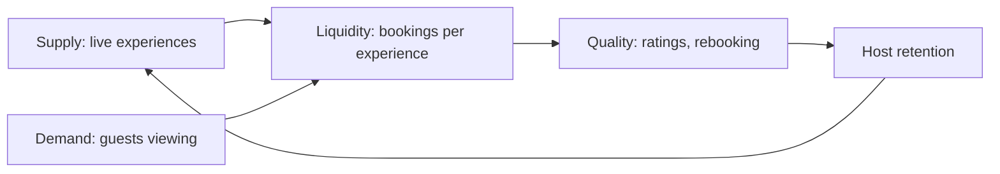

::interviewer 00:00
Airbnb Experiences just launched in a new city. What would you track in the first 90 days?

::candidate 00:05
Clarifying questions:
1. Is the city new for Airbnb stays too, or only for Experiences?
2. What does success look like after 90 days: proving demand, or reaching scale?

::interviewer
Airbnb stays already exist there. Goal: prove the marketplace works and is worth scaling.

::candidate 00:20
Good: we have existing guest demand. Experiences is a two-sided marketplace: **hosts** offering activities (cooking classes, tours) and **guests** booking them.

Plan: metrics by launch phase, because what matters changes over 90 days.

::candidate 00:35
**Phase 1 (days 0–30): supply.**
- # of live experiences; category coverage (food, outdoor, culture, nightlife)
- Host activation rate (applied → approved → live)
- Listing quality (photos, descriptions, availability per week)

**Phase 2 (days 15–60): demand and liquidity.**
- % of guests staying in the city who view Experiences
- View → booking conversion
- **Liquidity:** % of experiences booked at least once a week; % of searches that result in a booking
- Average group fill rate (seats booked ÷ seats offered)

**Phase 3 (days 45–90): quality and repeat.**
- Ratings and reviews; cancellation rates (host and guest)
- Host retention (still active after 60 days) and host earnings
- Guest rebooking of another experience; attach to stays

::interviewer
If you could pick only one metric at day 90, which one?

::candidate 01:20
**Bookings per 100 guest stays in the city (attach rate)**, ideally with quality above a threshold (average rating 4.7+). It shows demand from the existing guest base, enough supply to convert it, and it's the number that determines whether scaling to more cities is worthwhile. If attach is strong but host retention is weak, I'd dig into host economics before scaling.

**Guardrails:** host earnings (supply sustainability), safety incidents, guest complaints, impact on stay bookings (Experiences shouldn't distract from the core business).

**Summary:** Track supply first, then liquidity, then quality and repeat, with attach rate as the single most important day-90 metric and host earnings and safety as guardrails.

::scorecard
- **Phased metrics** matching launch dynamics.
- **Liquidity focus** for a new marketplace.
- **Clear single-metric choice** with conditions.
