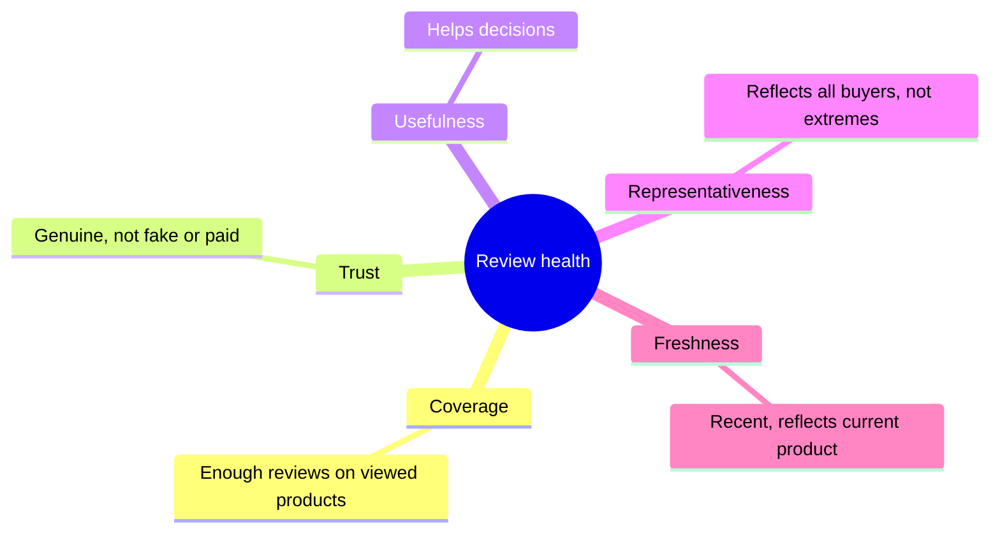

::interviewer 00:00
How would you measure the health of Amazon's product reviews?

::candidate 00:05
Clarifying questions:
1. Is this for the reviews team as a whole, or a specific problem like fake reviews?
2. Which side matters most: shoppers reading reviews, or getting customers to write them?

::interviewer
The whole reviews system. Both sides.

::candidate 00:20
Plan: (1) why reviews matter, (2) dimensions of review health, (3) metrics per dimension, (4) the overall North Star, (5) guardrails.

**1. Why reviews matter:** reviews help shoppers decide with confidence, which drives conversion and reduces returns, and they help good sellers win. If reviews become untrustworthy, customers stop relying on them, and Amazon loses a key advantage.

**2. Dimensions of health:**

::candidate 00:55
**3. Metrics:**

| Dimension | Metrics |
|---|---|
| **Coverage** | % of product views where the product has 5+ reviews; review rate (reviews ÷ orders) |
| **Trust** | % of reviews removed as fake/incentivized; % from verified purchases; manipulation reports; ratio of sudden review spikes |
| **Usefulness** | Helpful votes per review; % of sessions where reviews are read before purchase; conversion lift when reviews are present vs absent |
| **Representativeness** | Rating distribution vs return/complaint rates (5-star average with high returns suggests manipulation) |
| **Freshness** | % of reviews from the last 6 months on active products |

::interviewer
How would you know reviews are trustworthy without knowing which ones are fake?

::candidate 01:30
Use **proxies that compare reviews with independent signals**: e.g. a product with a 4.8 rating but a return rate well above its category average suggests the reviews don't reflect real experience. Others: rating differences between verified and unverified reviews; sudden bursts of 5-star reviews; reviewer behaviour patterns. Plus periodic **human audits** on random samples to estimate fake prevalence.

::candidate 01:55
**4. North Star:** **share of purchases where the shopper read trustworthy reviews**, together with the **gap between average rating and actual satisfaction** (measured by returns and complaints). The first shows reviews are used; the second shows they're honest.

**5. Guardrails:** don't push review volume with incentives that bias reviews (paid reviews violate policy); review request emails shouldn't annoy customers (unsubscribe rate); false positive removals of genuine reviews (seller complaints, appeals).

**Summary:** Review health has five dimensions: coverage, trust, usefulness, representativeness and freshness. I'd measure each, with the North Star being purchases informed by trustworthy reviews and the rating-vs-satisfaction gap as the key trust check.

::scorecard
- **Multidimensional definition of "health".**
- **Clever proxy for trust** (rating vs return rate).
- **Guardrails against gaming review volume.**
