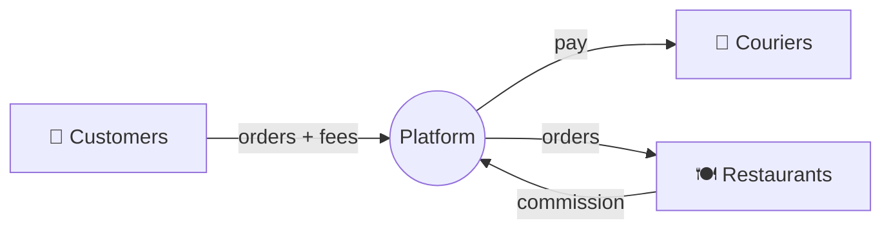

::interviewer 00:00
Design a metrics dashboard for the CEO of a food delivery company.

::candidate 00:05
Clarifying questions:
1. How often will the CEO look at it: daily, weekly, for board meetings?
2. How many markets? Should it support drilling down by city?
3. What's the company's current focus: growth or profitability?

::interviewer
Weekly review, with the option to check daily. 50 cities. Focus is profitable growth.

::candidate 00:25
Plan: (1) principles for an executive dashboard, (2) the business model and three sides of the marketplace, (3) the metric hierarchy, (4) layout, (5) alerts and how it would be used.

**1. Principles:**
- **One page, hierarchical:** the North Star at the top, then the health of each side, then economics.
- **Trends and targets**, not just numbers: week-over-week, year-over-year, vs plan.
- **Leading + lagging indicators:** revenue is lagging; supply at peak is leading.
- **Drill-down by city** so the CEO can spot where problems are.
- **Fewer metrics, chosen carefully:** about 15–20 in total.

::candidate 01:00
**2. Business model:** a three-sided marketplace (customers, restaurants, couriers). The platform earns commissions from restaurants plus delivery and service fees from customers, minus courier pay, promotions, and operating costs.

::candidate 01:20
**3. Metric hierarchy:**

**Tier 1: headline (top row)**
- ⭐ **Orders delivered per week** (North Star: value delivered to all three sides)
- **GMV** (gross order value)
- **Contribution margin per order** (profitability focus)

**Tier 2: marketplace health**

| Customers | Restaurants | Couriers |
|---|---|---|
| Monthly active customers | Active restaurants | Active courier hours (esp. at peak) |
| Orders per customer per month | % online during peak hours | Utilization (% of time on a delivery) |
| New customers + CAC | Avg restaurant rating | Earnings per hour |
| 30-day retention (cohorts) | Restaurant churn | Courier churn |

**Tier 3: customer experience / operations**
- Average and p90 delivery time; % on time
- Order accuracy (missing/wrong items)
- Cancellation rate
- Support contacts per 100 orders; CSAT

**Tier 4: unit economics**
- Take rate (revenue ÷ GMV)
- Delivery cost per order
- Promotions as % of GMV
- Contribution margin by city (top and bottom 5)

::interviewer
That's a lot. If the CEO could only look at three numbers each morning, which would they be?

::candidate 02:30
1. **Orders delivered (vs plan):** are we growing?
2. **Contribution margin per order:** are we growing profitably?
3. **% delivered on time:** are we keeping customers happy? This is a leading indicator of retention.

Together they cover growth, profit and experience, the three things that can go wrong.

::coach
"Pick only three" tests prioritization. A great answer covers distinct dimensions (growth, profit, quality) rather than three versions of growth.

::candidate 02:55
**4. Layout:**
- Top: three headline tiles with sparklines and vs-plan colours.
- Middle: three columns (customers, restaurants, couriers).
- Bottom: experience and unit economics, with a city heatmap (margin and on-time %).
- Filters: city, week, platform.

**5. Alerts & usage:**
- Automatic alerts if a city breaches a threshold (e.g. on-time below 85%, courier hours at peak down 10% week over week).
- Weekly review: the CEO checks headline vs plan, then the biggest movers by city, then asks the responsible team leads.

**Summary:** A one-page dashboard with orders delivered as the North Star, contribution margin for profitability, then health metrics for each side of the marketplace, experience metrics and unit economics, with drill-down by city and alerts on leading indicators.

::scorecard
- **Executive dashboard principles** stated first.
- **Clear hierarchy** covering all three sides.
- **Excellent prioritization** under the "only three" constraint.
- **Usage and alerts** make it operational, not just a list.
