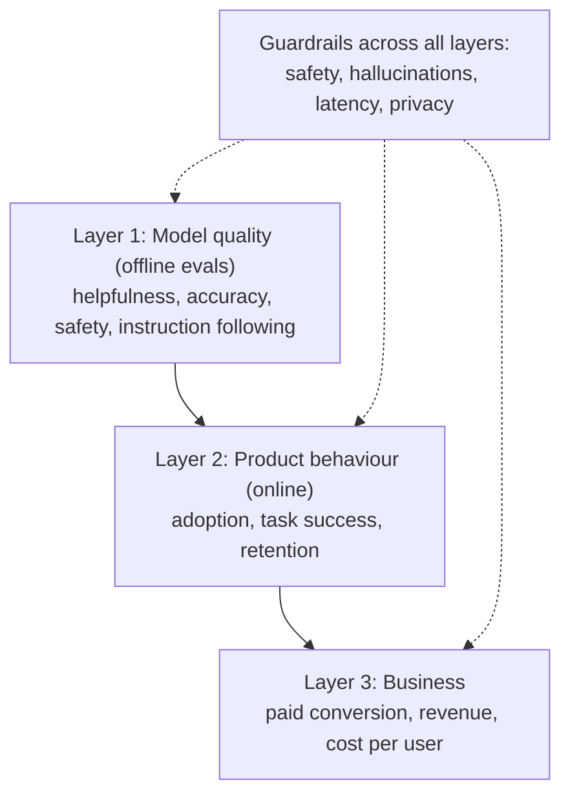

::interviewer 00:00
How would you measure the success of an AI assistant like ChatGPT, Gemini or Claude?

::candidate 00:05
Clarifying questions:
1. Consumer product or enterprise?
2. General assistant, or a specific use case like coding?
3. Is this for launch readiness, or ongoing product health?

::interviewer
Consumer, general assistant, ongoing product health.

::candidate 00:20
Plan: (1) mission and value, (2) a layered measurement model, since AI products need both *model quality* and *product behaviour*, (3) the North Star, (4) guardrails including cost, (5) pitfalls in interpreting metrics.

**1. Mission:** help people get things done (write, learn, analyse, plan, code) faster and better. Value = **successful task completion** + **trust**.

::candidate 00:45
**2. Layered measurement:**

**Layer 1: model quality (offline, before and after each model change):**
- Eval sets by task type: writing, coding, maths, factual Q&A, advice.
- Human ratings (helpfulness, correctness, tone), plus automated graders (LLM-as-judge, unit tests for code).
- Safety evals: harmful content, jailbreak resistance, and *over-refusal* (refusing harmless requests is also a failure).

**Layer 2: product behaviour (online):**
- **Adoption:** weekly active users, new user activation (first successful task).
- **Engagement:** conversations per user per week, days active per week.
- **Task success (inferred):** user copies or uses the output, positive feedback, no immediate rephrasing of the same question, conversation ends after a satisfying answer.
- **Retention:** week-1 and week-4 retention by cohort; is it becoming a habit?
- **Satisfaction:** thumbs-up ratio, periodic surveys.

**Layer 3: business:** free → paid conversion, ARPU, paid retention, **compute cost per active user**.

::candidate 01:55
**3. North Star:** **weekly active users who successfully complete at least one task**. It combines breadth (users), frequency (weekly), and value (success), and it's hard to inflate without delivering value.

::interviewer
Why not "time spent" or "messages per user"? Engagement is usually the North Star for consumer apps.

::candidate 02:15
For an assistant, longer conversations can mean **failure**: the user had to rephrase five times. The best answer might end the conversation in one turn. So time and message counts are ambiguous. I'd still track them, but interpret them alongside success signals. For example, if messages per user go up *and* rephrasing rate goes up, that's bad; if messages go up because people use it for more tasks, that's good.

::coach
For AI assistants, the classic trap is equating engagement with value. A great answer explains why more messages can mean worse quality.

::candidate 02:45
**4. Guardrails:**
- **Accuracy:** hallucination rate (reported + sampled audits), especially for health, legal, finance.
- **Safety:** policy violation rate, successful jailbreaks.
- **Over-refusal rate.**
- **Latency:** time to first token, full response time.
- **Cost:** compute cost per conversation and per active user (LLMs have real marginal costs).
- **Privacy:** incidents, data deletion requests honoured.

**5. Pitfalls:**
- **Thumbs-up bias:** few users rate; those who do may be unrepresentative. Use sampling + human review too.
- **Novelty effects:** early engagement may fade.
- **Model changes:** a new model may improve evals but change style users liked. A/B test model releases on online metrics before full rollout.

**Summary:** Measure an AI assistant in layers: offline model quality, online product behaviour, and business outcomes, with a North Star of weekly users who successfully complete tasks, and guardrails on accuracy, safety, over-refusal, latency and cost per user.

::interviewer
Thumbs-up rate went up after a model update, but week-4 retention dropped. What happened?

::candidate 03:30
Possible explanations: (1) the new model is more agreeable or flattering, so users rate it well in the moment, but it's less useful for real tasks (a known risk of optimizing for in-the-moment approval); (2) rating population shifted (a UI change prompted ratings from happier users); (3) the update hurt a specific use case, like coding, used by high-retention power users. I'd segment retention by use case and user type, compare eval results by task, and look at rephrasing and task-success rates. If (1), I'd rebalance training and evals toward actual usefulness and honesty, not just approval.

::scorecard
- **Layered measurement model** fit for AI products.
- **Defended a success-based North Star** against engagement metrics.
- **Cost and over-refusal guardrails** show AI-specific expertise.
- **Strong diagnostic answer** to conflicting signals.
