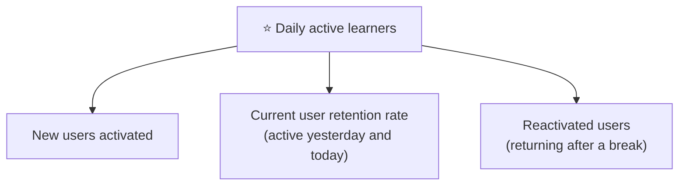

::interviewer 00:00
What should Duolingo's North Star metric be?

::candidate 00:05
Clarifying question: should the North Star reflect the business (revenue), engagement, or learning outcomes? I'll propose one and explain the trade-offs.

::interviewer
Go ahead.

::candidate 00:15
Plan: (1) Duolingo's mission and how value is created, (2) candidates, (3) choice and justification, (4) input metrics, (5) guardrails.

**1. Mission and value:** Duolingo's mission is to make language education free and accessible. Learning a language takes **consistent practice over months**, so the core value mechanism is **habit**: if people practise daily, they learn; if they stop, they don't. Revenue (Super subscriptions, ads) follows from engaged learners.

::candidate 00:40
**2. Candidates:**

| Candidate | Pros | Cons |
|---|---|---|
| Revenue / subscribers | Business outcome | Lagging; doesn't guide product teams |
| Lessons completed | Activity | Can be gamed with short, easy lessons |
| **Daily active learners** (completed ≥1 lesson) | Reflects habit, which drives learning; simple | Doesn't directly measure proficiency |
| Proficiency gained | Closest to mission | Hard to measure frequently; slow |

**3. Choice: daily active learners (DAU where "active" = completed at least one lesson).** Habit is the engine of learning, it's measurable daily, and it predicts both learning and revenue. Duolingo has publicly described focusing on DAU and growing it substantially.

::interviewer
Doesn't that encourage gamification over real learning?

::candidate 01:15
It can, which is why the guardrail on **learning outcomes** is essential. Streaks and leagues can produce "streak maintenance" behaviour (doing one easy lesson just to keep the streak) without much learning. I'd track:
- Proficiency assessments over time (e.g. periodic checkpoints, CEFR estimates).
- Share of lessons at the appropriate difficulty (not just easy review).
- Long-term retention (people who aren't learning eventually quit).

If DAU grows but learning metrics decline, that's a signal to rebalance.

::candidate 01:40
**4. Input metrics (DAU decomposition):**

Duolingo has said publicly that improving **current user retention rate** had an outsized effect on DAU, because retaining people who are already active compounds over time.

**5. Guardrails:** learning outcomes (proficiency), notification fatigue (opt-outs), wellbeing (streak anxiety signals), Super conversion and revenue health.

**Summary:** Duolingo's North Star should be daily active learners, because habit is what makes language learning work and it predicts revenue. Break it into new, retained and reactivated users, and guard it with learning outcome metrics so gamification never replaces real progress.

::scorecard
- **Explained the value mechanism** (habit → learning → revenue).
- **Candidate comparison** and a well-defended choice.
- **Learning guardrail** answers the gamification concern.
- **DAU decomposition** gives actionable inputs.
