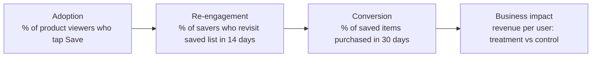

::interviewer 00:00
You just launched a "Save for later" button on a shopping app. How do you know it worked?

::candidate 00:05
Clarifying questions:
1. Was it launched as an A/B test, or to everyone?
2. Why was it built: what problem was it meant to solve?
3. Where does it appear: product pages, cart, or both?

::interviewer
A/B test, 50/50. Built because many users leave product pages without buying. On product pages.

::candidate 00:25
**Hypothesis:** shoppers often aren't ready to buy immediately (comparing, waiting for payday). Without a way to save, they lose the product and don't come back. "Save for later" preserves intent, so **more of them return and buy later**.

Plan: (1) a metric funnel from adoption to business impact, (2) primary metric, (3) guardrails, (4) test design details, (5) decision rule.

::candidate 00:45
**1. Funnel of metrics:**

Adoption alone doesn't prove value: people might save and never return. So I'd follow the chain to purchases and revenue.

::candidate 01:05
**2. Primary metric:** **30-day revenue per user** (or 30-day purchase rate), treatment vs control. That's the true test of the hypothesis.

**Secondary:** save rate, saved list revisits, saved item purchase rate, return visits within 7 days.

::interviewer
What if people who would have bought now just save instead, and some never come back?

::candidate 01:25
Exactly the risk: **cannibalization of immediate purchases**. That's why the primary metric is net revenue per user over 30 days, not saves. I'd also watch **immediate add-to-cart rate** as a guardrail. If add-to-cart drops but 30-day revenue rises, the feature is shifting purchases later but increasing them overall, which is fine. If both drop, the feature is hurting us.

::candidate 01:45
**3. Guardrails:** immediate add-to-cart/purchase rate, page load time, app crashes, notification unsubscribe rate if we send "price dropped on your saved item" reminders.

**4. Test design:**
- **Duration:** at least 30 days of observation because of the delayed purchase effect. Possibly run the exposure for 2 weeks, then observe outcomes for 30 days after.
- **Randomization unit:** user (not session), so the same user sees a consistent experience.
- **Sample size:** based on the baseline purchase rate and the minimum detectable effect we care about (e.g. +1% revenue per user).

**5. Decision rule:** ship if 30-day revenue per user is significantly higher and guardrails are fine. Then consider follow-ups: reminders ("still interested?"), price-drop alerts, sharing saved lists.

**Summary:** Success means more total purchases over time, not just saves. I'd track a funnel from adoption to purchases, with 30-day revenue per user as the primary A/B metric, and guard against cannibalizing immediate purchases.

::scorecard
- **Hypothesis-driven** metric design.
- **Funnel from adoption to business impact.**
- **Cannibalization handled** with the right primary metric and guardrail.
- **Test design details** (duration for delayed effects, randomization unit).
