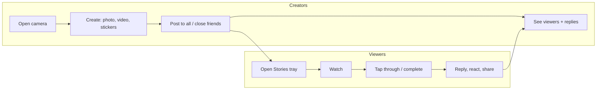

::interviewer 00:00
How would you measure the success of Instagram Stories?

::candidate 00:05
Great. A few clarifying questions:
1. Is this the mature Stories product today, or Stories at launch?
2. Is there a specific decision this measurement supports, e.g. a quarterly health check or evaluating a change?
3. Should I include monetization (Stories ads)?

::interviewer
Mature product. Think of it as defining the team's success metrics for the year. Include ads briefly.

::candidate 00:30
Thanks. My plan: (1) the **purpose** of Stories, (2) the **users and actions** that show value, (3) a **metric menu** across the funnel, (4) pick **one North Star**, (5) **guardrails**, (6) trade-offs and how metrics could be gamed. OK?

::interviewer
Sure.

::candidate 00:50
**1. Purpose.** Stories exists to make sharing **casual and low-pressure**. Posts disappear after 24 hours, so people share everyday moments they wouldn't put on their permanent grid. It keeps Instagram **personal and social**, strengthening the friend graph, which is Instagram's moat against pure entertainment apps. For the business, Stories is also a big ad surface.

So success = **people share everyday moments, and friends see and respond to them**.

::candidate 01:20
**2. Users and actions (two sides):**

The **value moment** is when a story gets a reaction or reply: that's a social connection. A view without interaction is weaker.

::candidate 01:50
**3. Metric menu:**

| Stage | Creators | Viewers |
|---|---|---|
| Reach | % of DAU who post ≥1 story/day | % of DAU who view stories |
| Engagement | Stories posted per poster; % using stickers, music | Stories viewed per viewer; completion rate |
| Interaction | Replies/reactions received per story | Replies + reactions sent per 1,000 views |
| Retention | 7-day repeat posting rate | Days per week viewing |
| Quality | Close friends share; % personal vs reposts | Skip rate, mutes, "see fewer" |
| Monetization | — | Story ad impressions, ad completion, CTR, revenue |

::candidate 02:30
**4. North Star:** **daily active users who post a story OR reply/react to one** ("daily story participants").

Why:
- It captures **both sides** (sharing and responding).
- It reflects the **mission** (social connection), not passive consumption.
- It's harder to game than views, which can be inflated by autoplay, reposted content, or ranking changes.

Alternatives considered: "stories posted per day" ignores whether anyone cares; "time spent in Stories" rewards passive consumption and ads.

::interviewer
Why not stories viewed? It's the biggest number.

::candidate 03:00
Views measure exposure. They can go up because of things that don't reflect value: autoplaying more stories, inserting more creator or brand stories, or showing more ads between them. A view where the user taps past in half a second isn't a connection. I'd keep views and completion as **supporting metrics**, but they could rise while friend interaction falls, which would mean Stories is drifting away from its purpose.

::coach
Defending the North Star against the "obvious" volume metric is often the most important moment in a metrics interview. Explain how the obvious metric could be gamed or could rise without real value.

::candidate 03:30
**5. Guardrails:**
- **Feed and Reels health:** posts and time in other surfaces (cannibalization).
- **Ad load vs experience:** story completion rate around ads, "hide ad" rate.
- **Safety:** reports and blocks related to stories.
- **Creator wellbeing:** posting frequency among creators who stop (pressure signals).

**6. How it could be gamed / trade-offs:** the team could boost participation with quick-reaction emoji prompts that create low-value interactions. So I'd also track **reply rate** (messages, not just emoji) as a quality check.

**Monetization briefly:** ad revenue per DAU from Stories, CPM and ad completion, balanced against the guardrails above.

**Summary:** Stories exists for casual sharing between friends, so my North Star is daily story participants: people who post or respond. Supporting metrics cover reach, engagement and quality, with guardrails on cannibalization, ad load and safety.

::interviewer
Story posts dropped 10% last month. How would you investigate?

::candidate 04:15
I'd check data validity first (logging changes), then whether the drop is sudden or gradual, segment by platform, country, app version, new vs existing users and creator type, and decompose: is it fewer posters or fewer stories per poster? Then check internal changes (camera redesign, ranking, a new feature competing for posting) and external ones (competitor features, seasonality). Happy to go deeper.

::scorecard
- **Purpose-first metrics:** the North Star reflects the specific mission.
- **Two-sided user actions** mapped visually.
- **Strong defence of the North Star** against vanity metrics.
- **Guardrails + gaming risks** show maturity.
- **Smooth transition** into the root-cause follow-up.
