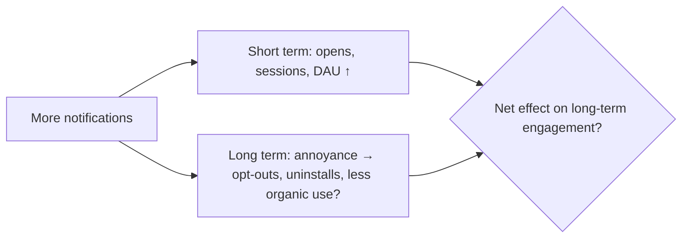

::interviewer 00:00
How would you measure whether push notifications are helping or hurting your app?

::candidate 00:05
Clarifying questions:
1. What kind of app? Notifications for a social app differ from a ride app.
2. Which notifications: transactional (your ride is here) or engagement/marketing (you have new likes)?

::interviewer
A social app. Engagement notifications.

::candidate 00:20
Transactional notifications are almost always valued. The debate is about **engagement notifications**, which can bring people back, but also annoy them.

Plan: (1) short-term vs long-term effects, (2) metrics for each, (3) the right experiment design, (4) decision rules.

::candidate 00:40
**1. Short-term vs long-term:**

The key insight: **short-term A/B tests almost always show notifications "working"**, because opens go up within days. The harm (people disabling notifications, uninstalling, or getting used to them) shows up over weeks or months.

**2. Metrics:**
- **Short-term:** notification open rate, sessions attributed to notifications, DAU lift.
- **Long-term / health:** notification opt-out rate (in-app and OS settings), uninstall rate, **organic sessions** (sessions not triggered by notifications), 30/60/90-day retention.
- **Quality:** % of notification sessions that lead to meaningful actions (comment, post) vs instant bounce.

::interviewer
How would you design the experiment?

::candidate 01:20
**A long-term holdout:** keep a small random group (e.g. 1–5% of users) on a much lower notification volume, or none for engagement notifications, for several months. Compare against users getting the normal volume on:
- total and organic engagement,
- retention,
- opt-out and uninstall rates.

Also run **volume experiments** (e.g. 1/day vs 3/day vs 5/day) to find the point where marginal value turns negative. And **personalized throttling**: send fewer to users who rarely open them.

::coach
"Long-term holdout" is the key phrase. It shows you understand that short-term A/B tests overstate notification value.

::candidate 01:55
**4. Decision rules:**
- Notifications help if holdout comparisons show **higher long-term retention and organic engagement**, not just more opens.
- If opt-outs rise significantly for a notification type, reduce or redesign it, because an opted-out user can't be reached even for important notifications later.
- Every notification type gets a "value score" (meaningful actions per send minus opt-out cost).

**Summary:** Short-term opens always look good. To know if notifications truly help, run long-term holdouts and measure retention, organic usage, opt-outs and uninstalls, and optimize volume per user based on net long-term value.

::scorecard
- **Short vs long-term distinction**, the central insight.
- **Long-term holdout + volume tests** as the right method.
- **Practical decision rules.**
