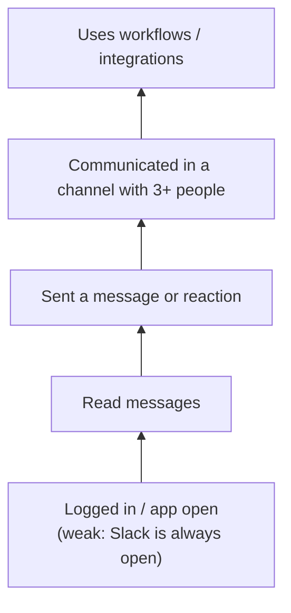

::interviewer 00:00
How would you define engagement for Slack, and how would you measure it?

::candidate 00:05
Clarifying questions:
1. Is this for a user-level metric, a workspace-level metric, or both?
2. What decisions will it support: product health, predicting churn, or sales/expansion?

::interviewer
Both levels. Mainly to understand product health and predict renewals.

::candidate 00:20
Plan: (1) what value Slack delivers, (2) define "engaged" at the user level with a ladder, (3) the workspace level, (4) metrics, (5) why it predicts renewal.

**1. Value:** Slack replaces scattered email and meetings with **organized, real-time team communication**, plus integrations that bring work into one place. So engagement should reflect **real communication and collaboration**, not having the app open.

::candidate 00:45
**2. User-level engagement ladder:**

**Definition:** an **engaged user** = in a week, sent at least one message (or reaction) on 3+ days, including at least one in a shared channel. "App open" is too weak because Slack sits open in a background tab all day.

**3. Workspace-level definition:** an **engaged workspace** = at least 70% of paid seats are engaged users in a week, AND messages are spread across channels (not one person broadcasting).

::interviewer
Why does seat-level engagement matter so much?

::candidate 01:20
Because Slack sells **seats**. At renewal, admins look at how many seats are actually used. If only half the seats are active, they cut seats, which reduces revenue (contraction), or question the value overall (churn). High seat utilization also signals that Slack has become *how the team works*, which creates switching costs.

::candidate 01:40
**4. Metrics:**
- **Seat utilization:** weekly engaged users ÷ paid seats (core health metric).
- **Messages per engaged user per day; % in channels vs DMs** (more channel usage = more open, team-wide collaboration).
- **Breadth:** number of active channels per workspace; cross-team channels; Slack Connect channels with external partners.
- **Depth:** workflows run, integration events, huddles.
- **Stickiness:** engaged days per week (DAU/WAU).

**5. Predicting renewal:** I'd build a **workspace health score** from leading indicators: seat utilization trend, breadth of channels, integrations count, admin activity, and a drop in activity from key champions. Validate it by checking how well past health scores predicted renewals and expansions. Customer success teams then act on at-risk accounts.

**Summary:** Slack engagement should measure real communication: users who send messages regularly in shared channels, and workspaces where most paid seats are engaged. Seat utilization plus breadth and depth form a health score that predicts renewals.

::scorecard
- **Engagement ladder** that rejects weak "app open" signals.
- **Business link** (seats → renewals) explained clearly.
- **Health score validated against outcomes.**
