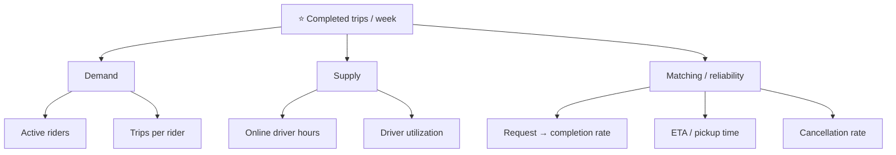

::interviewer 00:00
What's the North Star metric for Uber? Why?

::candidate 00:05
Clarifying question: should I focus on Uber's rides business (Mobility), or the whole company including Uber Eats and Freight?

::interviewer
Rides.

::candidate 00:15
Plan: (1) the value Uber creates, (2) candidate metrics, (3) choose the North Star and explain, (4) input metrics (the drivers), (5) guardrails.

**1. Value created.** Uber is a marketplace: riders get reliable, fast transportation; drivers get flexible earnings; Uber takes a share. All three get value at the same moment: **when a trip is completed**.

::candidate 00:40
**2. Candidates:**

| Metric | Pros | Cons |
|---|---|---|
| Gross bookings ($) | Close to revenue, investors track it | Can grow via price increases without more value; dollars vary by city |
| Monthly active riders | Breadth | Misses frequency and supply |
| Requests | Demand signal | Doesn't show if fulfilled |
| **Completed trips per week** | Captures demand, supply and reliability together | Doesn't capture trip value or profitability |
| Revenue / take rate | Business outcome | Lagging, can be gamed with fees |

**3. North Star: completed trips per week.** It grows only when riders want rides, drivers are available, and matching works. It's simple, actionable, and predictive of revenue.

::interviewer
But a trip in New York earns far more than one in a smaller city. Shouldn't you use bookings?

::candidate 01:30
True: trips aren't equally valuable. Bookings are a great **company-level financial metric** and I'd track them closely. But as a *North Star for product teams*, bookings have issues: they rise with price increases even if riders get less value, and they can push teams toward high-fare markets only. Trips are a better measure of **delivered utility**. To capture value, I'd pair the NSM with gross bookings and contribution margin as business counterweights. Pairing a North Star with a financial counterweight is a common pattern for exactly this reason.

::coach
When challenged on your North Star, don't abandon it. Acknowledge the weakness, then show how a counterweight metric covers it.

::candidate 02:00
**4. Input metrics (tree):**

Each team owns an input: growth (active riders), driver team (online hours), marketplace (ETA, completion rate).

**5. Guardrails:**
- Safety incidents per million trips.
- Driver earnings per hour (can't grow trips by squeezing drivers).
- Price perception and surge frequency.
- Contribution margin per trip (no growth bought with subsidies).
- Rider ETA (don't grow volume with a poor experience).

**Summary:** The North Star is completed trips per week, because it captures value for riders, drivers and Uber at once and depends on demand, supply and matching. It's paired with bookings and margin as business counterweights, input metrics per team, and guardrails on safety, driver earnings and price perception.

::scorecard
- **Value-moment reasoning** ("all sides get value when a trip completes").
- **Candidate comparison table** and a defended choice.
- **Handled the "trip value differs" pushback** with an NSM + financial counterweight.
- **Input metric tree** mapped to teams.
