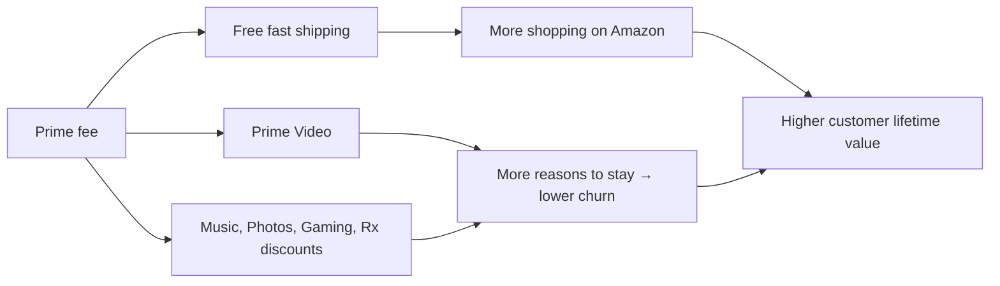

::interviewer 00:00
Why does Amazon Prime bundle so many services? Is it worth it for Amazon?

::candidate 00:05
I'll cover (1) what Prime is for strategically, (2) why bundling works, (3) the economics, and (4) my verdict and risks.

**1. Strategic purpose.** Prime's main job isn't to make money from the membership fee. It's to **change shopping behaviour**: make Amazon the default place people shop, and increase how often and how much they buy. Free fast shipping removes the main reason to hesitate before ordering ("Is shipping worth it?"). Members have been widely reported to spend significantly more per year than non-members.

**2. Why bundle many services (video, music, photos, games, grocery perks)?**

- **Perceived value > price:** a bundle feels like a great deal when users value even 2–3 of its parts.
- **Different reasons to join:** some join for shipping, others for video. The bundle attracts more segments.
- **Lower churn:** cancelling means losing *everything*; each service adds a reason to stay.
- **Engagement:** Prime Video creates frequent touchpoints with Amazon even when not shopping.
- **Price discrimination:** the bundle extracts value from varied preferences without separate prices for everything.

::interviewer
But Prime Video costs billions in content. How can that be worth it?

::candidate 01:15
The return is measured in **retention and shopping**, not video revenue alone. Amazon has said Prime Video helps attract members and that members who watch video convert to paid at higher rates and renew more often. If video increases membership and renewal rates meaningfully across a very large base, and members spend much more on shopping, the content investment can pay off. Video also now brings **ad revenue** (Prime Video introduced ads by default with an ad-free upgrade option) and channels revenue (subscriptions sold through Prime Video).

**3. Economics:**
- Revenue: membership fees (a large subscription business by itself) + increased retail spending + ads + third-party seller fees.
- Costs: shipping (big), content, other services.
- The key: **incremental gross profit from members' extra purchases + fees > cost of benefits**.

**4. Verdict:** yes, it's one of the most successful loyalty programmes. It creates a **moat** through habit and switching costs, and funds the logistics network that further improves delivery speed (a flywheel).

**Risks:** rising shipping and content costs, regulatory scrutiny (e.g. the FTC's case about difficult Prime cancellation flows), and members who only join for one benefit and churn after events like Prime Day.

**Metrics:** membership growth, renewal rate, spend per member vs non-member (incremental), benefit usage (how many services each member uses), cost per member, churn after free trials.

::scorecard
- **Correct strategic framing** (behaviour change, not fee revenue).
- **Bundling economics** with a flywheel diagram.
- **Handled the content-cost challenge** with retention logic.
- **Risks and metrics** including regulatory scrutiny.
