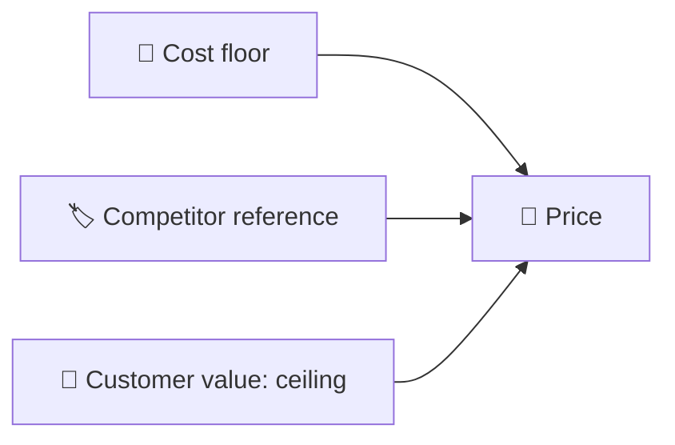

::interviewer 00:00
How would you price a new B2B SaaS analytics product?

::candidate 00:06
Let me ask a few questions first:
1. What does the product do, and who's the buyer?
2. What's the business goal: fast adoption to win the market, or maximizing revenue early?
3. Are there competitors, and how do they price?
4. What's our cost structure: is serving each customer expensive (e.g. heavy data processing)?

::interviewer
It's a product analytics tool (like Mixpanel or Amplitude). Buyers are product teams at mid-size tech companies. The goal: land customers quickly but show healthy unit economics for investors. Competitors charge roughly by volume of tracked events. Data processing costs are meaningful.

::candidate 00:40
Thanks. My structure:
1. **Value to the customer** (price ceiling)
2. **Cost to serve** (price floor)
3. **Competition** (market reference)
4. **Pricing model and value metric**
5. **Packaging into tiers**
6. **Price points**
7. **Testing and iteration**

::candidate 01:00
**1. Value (ceiling).** What does it do for a mid-size product team?
- Saves analyst time: e.g. ~20 hours/month of SQL queries and reporting at ~$80/hour ≈ **$1,600/month**.
- Better decisions: improving conversion or retention by even 1% can be worth much more for a company with $20M revenue.
So value is likely **thousands of dollars per month** per customer. Pricing at a fraction of that (10–30%) makes the purchase easy to justify.

**2. Cost to serve (floor).** Data ingestion, storage and queries scale with event volume. Suppose ~$0.05 per 1,000 events in infrastructure plus support and onboarding. For a customer tracking 10M events/month, that's ~$500 in data cost. Our price must comfortably exceed this to reach healthy **gross margins (~75–80%+)** typical of SaaS.

**3. Competition.** Competitors price by tracked events/users, with free tiers for small volumes, and enterprise plans in the tens of thousands per year. That sets buyers' expectations.

::interviewer
What would you charge for: seats, events, or something else?

::candidate 01:50
This is the most important decision: the **value metric**. Good value metrics (a) grow with the customer's value, (b) align with our costs, (c) are easy to understand and predict.

| Option | Grows with value? | Aligned with cost? | Predictable? | Risk |
|---|---|---|---|---|
| Per seat | Somewhat | ❌ (cost is data, not users) | ✅ | Discourages sharing dashboards across teams, which hurts adoption |
| **Per tracked users (MTUs) / event volume** | ✅ (more product usage = more value) | ✅ | Medium | Bill shock if usage spikes |
| Flat fee | ❌ | ❌ | ✅✅ | Leaves money on the table / losses on heavy users |

I'd choose **volume-based (monthly tracked users or events)** as the core metric, with **unlimited seats**. Unlimited seats encourage the whole company to use the tool, which increases stickiness. To address bill shock: volume bands with predictable prices, alerts, and annual commitments with overage protection.

::coach
Naming and justifying the **value metric** is what separates great pricing answers from good ones. Evaluate options on value alignment, cost alignment and predictability.

::candidate 02:40
**5. Packaging (good–better–best + free):**

| Tier | Who | Includes | Price (illustrative) |
|---|---|---|---|
| **Free** | Startups, evaluation | Up to 100k events/month, core reports, 1 project | $0: acquisition (product-led growth) |
| **Growth** | Mid-size product teams | Up to 10M events, all reports, integrations, unlimited seats | ~$1,000/month (annual) |
| **Business** | Larger teams | Higher volumes, advanced analysis (cohorts, experiments), data governance | ~$3,000+/month |
| **Enterprise** | Large companies | SSO, audit logs, SLAs, dedicated support, data warehouse sync | Custom: also anchors the other tiers |

**6. Price points:** ~$1,000/month for 10M events is well under the value (~$1,600+ of time saved, plus decision value), above cost (~$500 of data + support → ~60–70% margin at entry; margins improve at higher tiers through volume discounts on infrastructure), and competitive.

**7. Test and iterate:**
- **Before launch:** customer interviews and willingness-to-pay surveys (e.g. Van Westendorp) with 20–30 target buyers.
- **After launch:** track free → paid conversion, win rate vs competitors, discount frequency (heavy discounting means the price is too high or the value story is weak), expansion revenue (net revenue retention), gross margin by tier.
- Revisit pricing every 6–12 months; grandfather early customers when changing.

**Summary:** price on a value metric that grows with usage and matches our costs (tracked volume), with unlimited seats to encourage adoption; package as free + growth + business + enterprise; set the entry paid tier around $1,000/month, below customer value and above cost; and validate with willingness-to-pay research and conversion, discount and margin metrics.

::scorecard
- **Value ceiling, cost floor, competitive reference** all considered with numbers.
- **Value metric analysis** with a clear rationale (unlimited seats to drive adoption).
- **Packaging table** with a free tier for product-led growth and an enterprise anchor.
- **Testing plan and metrics** (discounting as a signal).
