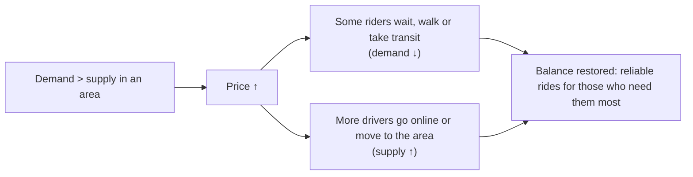

::interviewer 00:00
Explain and evaluate Uber's surge pricing.

::candidate 00:05
I'll cover (1) how it works, (2) the economics, (3) the benefits, (4) the problems, (5) how I'd improve it, and (6) metrics.

**1. How it works:** when ride requests in an area exceed available drivers, prices rise by a multiplier (or, more recently, through dynamic upfront prices). Riders see the higher price before booking; drivers see "busy" areas on a heat map.

**2. Economics: balancing a marketplace in real time.**

Without surge, demand spikes (concerts ending, rainstorms, New Year's Eve) would lead to **no cars at all**: everyone requests, few get rides, long waits.

**3. Benefits:**
- **Reliability:** a ride is available when you really need one (e.g. at 2am in the rain), at a price.
- **Driver earnings:** higher pay at the hardest times encourages drivers to work then.
- **Efficiency:** rides go to people who value them most at that moment.

::interviewer
Isn't it unfair, though? People see it as price gouging.

::candidate 01:10
That's the biggest problem. Perceived fairness matters a lot:
- **During emergencies** (storms, attacks), high prices feel exploitative; Uber faced strong backlash in such cases and introduced caps in emergencies.
- **Surprise:** older multiplier displays (e.g. "2.3×") confused people and felt arbitrary.
- **Equity:** lower-income riders are priced out at peak times.
- **Trust:** if users suspect the algorithm exploits them (e.g. low phone battery theories), the brand suffers.

So the economic logic is sound, but the product design determines whether people accept it.

**4–5. Improvements:**
1. **Upfront, all-in prices** instead of multipliers. Users decide based on the total, with no surprises.
2. **Transparency:** "Prices are higher due to increased demand in your area."
3. **Alternatives in the moment:** "Wait 10 minutes and save ~$8" or "Walk 3 minutes to a lower-priced area", cheaper options like shared rides or public transit suggestions.
4. **Emergency caps:** disable or cap surge during declared emergencies.
5. **Subscription benefits:** e.g. members get limited surge protection.
6. **Better forecasting:** predict demand spikes (events) and pre-position drivers with incentives, reducing the need for surge in the first place.

**6. Metrics:**
- Fulfilment rate and ETA during high demand (does surge restore reliability?).
- Conversion at surge prices; "wait and save" uptake.
- Driver supply response (online hours in surge areas).
- Complaints and sentiment about pricing; NPS.
- Share of trips with surge (lower is better if forecasting improves).

**Summary:** surge pricing balances supply and demand in real time, keeping rides available and rewarding drivers when it's hardest, but it can feel unfair. Upfront pricing, transparency, cheaper alternatives, emergency caps and better forecasting keep the benefits while protecting trust.

::scorecard
- **Clear economic explanation** with a diagram.
- **Balanced evaluation** including fairness and ethics.
- **Concrete product improvements** and metrics.
