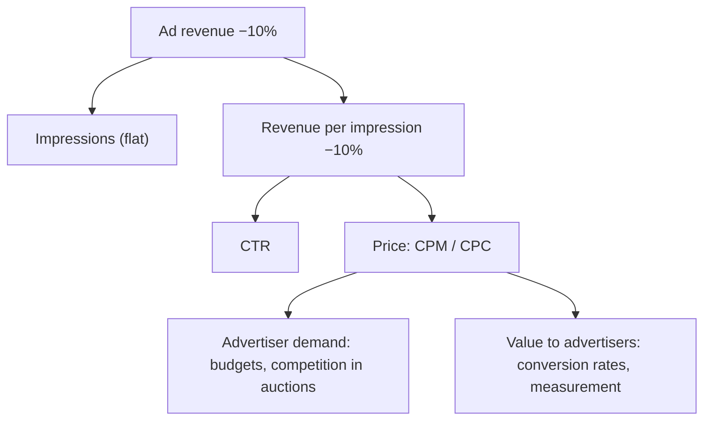

::interviewer 00:00
Ad revenue dropped 10% this month, but ad impressions are flat. What's happening?

::candidate 00:05
Clarifying questions:
1. What kind of platform: social media with feed ads?
2. Pricing model: CPM (per impression), CPC (per click), or a mix?
3. Global or regional? Sudden or gradual?

::interviewer
A social app with feed ads, mostly auction-based, a mix of CPM and CPC. Global, gradual over the month.

::candidate 00:25
**Decompose revenue:**

Revenue = impressions × (revenue per impression).
Revenue per impression = CTR × price per click (for CPC) or CPM ÷ 1,000.

Impressions are flat, so **revenue per impression fell ~10%**: either advertisers are paying less (lower bids/prices), or clicks/conversions fell (affecting CPC revenue and future bids).

Can I see CTR vs CPM/CPC trends?

::interviewer
CTR is flat. Average CPM and CPC are down about 10%.

::candidate 00:55
So **prices fell** while user behaviour (CTR) is stable. Prices in an auction depend on **advertiser demand** and **how much advertisers value our ads**.

**Hypotheses:**
1. **Seasonality:** e.g. January after the holiday season, when ad budgets drop sharply. Compare with the same month last year.
2. **Macroeconomic slowdown:** advertisers cutting budgets (especially certain verticals).
3. **A large advertiser vertical pulled back** (e.g. e-commerce or crypto advertisers).
4. **Measurement/targeting degradation:** privacy changes (e.g. OS tracking restrictions, cookie loss) reduce measured conversions, so advertisers' automated bids fall.
5. **Competition:** advertisers shifting budget to a competitor platform with better results.
6. **Our auction changes:** reserve price or ranking changes.
7. **Mix shift:** more impressions in lower-priced regions or surfaces (e.g. a new short-video surface with lower CPMs), which reduces the average price even if each market is unchanged.

::interviewer
How would you narrow it down?

::candidate 01:40
Segment price changes by:
- **Region:** if prices dropped in all regions equally, it's likely global (seasonality, macro, measurement). If only some regions, check mix shift.
- **Surface/placement:** feed vs stories vs video. If impressions shifted to a cheaper surface while prices per surface held, it's mix.
- **Advertiser vertical and size:** if one vertical's spend fell, it's demand-specific.
- **Objective type:** conversion campaigns vs awareness. If conversion campaigns' bids fell most, measurement is the likely issue (they bid on measured conversions).
- **Same period last year:** seasonality check.

::interviewer
Prices fell mostly in conversion-objective campaigns, across all regions, and not last year.

::candidate 02:15
That points to **measurement/targeting degradation**: conversion campaigns use automated bidding based on measured conversions; if fewer conversions are attributed (e.g. due to a privacy change, a broken conversion pixel/SDK update, or an attribution model change), advertisers' bids fall automatically.

**Confirm:** check reported conversions per click vs advertisers' own data; check for recent changes in our conversion tracking (SDK, server-side API), or external OS/browser privacy changes this month.

**Actions:**
- If it's our bug → fix tracking urgently, communicate with advertisers.
- If it's external privacy changes → invest in privacy-preserving measurement (server-side conversion APIs, modelled conversions, aggregated reporting), help advertisers adopt them, and improve on-platform conversion options (e.g. in-app checkout or lead forms).
- Monitor: CPM/CPC by objective, measured conversions per click, advertiser retention and spend.

**Summary:** With flat impressions and CTR, the drop came from lower ad prices, concentrated in conversion campaigns globally. That points to reduced conversion measurement lowering automated bids. Fix tracking or invest in privacy-safe measurement to restore advertiser value.

::scorecard
- **Revenue decomposition** into volume vs price.
- **Rich hypothesis list** across seasonality, demand, measurement and mix.
- **Smart segmentation** by campaign objective to isolate measurement issues.
