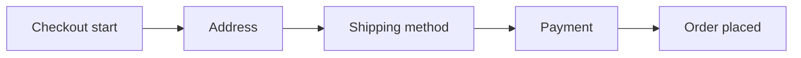

::interviewer 00:00
Checkout conversion on our e-commerce site dropped 8% yesterday. Walk me through how you'd investigate.

::candidate 00:05
Clarifying questions:
1. How is checkout conversion defined: from starting checkout to placing an order?
2. Compared to what: the day before, or the same weekday last week?
3. All devices and countries?

::interviewer
Checkout start → order placed. Compared to the same day last week. You'll have to find the scope.

::candidate 00:25
Structure: validate → locate in the funnel → segment → hypotheses (internal, external, mix) → fix.

**1. Validate:** Did orders in the **database** (backend) drop too, or only the analytics event? If backend orders are normal, it's a tracking problem (e.g. the "order confirmed" event broke in a release).

::interviewer
Backend orders are down too.

::candidate 00:40
Real drop, so urgent: it's revenue.

**2. Locate in the funnel:**

Can I see conversion for each step vs last week?

::interviewer
Payment → order placed is down sharply. Earlier steps are normal.

::candidate 01:00
So the problem is at the **payment step**. Next, segment the payment step:
- By **payment method** (cards, PayPal, Apple Pay, buy-now-pay-later)
- By **card network** (Visa, Mastercard, Amex)
- By **device/browser**
- By **country/currency**

::interviewer
It's mostly card payments, all networks, on all devices, in Europe only.

::candidate 01:20
Cards, Europe only, all devices. Hypotheses:
- **3-D Secure / Strong Customer Authentication (SCA):** a change in our checkout or payment provider's authentication flow (the extra bank verification step in Europe) is failing or timing out.
- **Payment processor outage** in the European region.
- **Currency/pricing bug** for EUR.
- **Fraud rule change** that's declining more European cards.

Data: payment processor error codes and decline reasons (e.g. "authentication failed", "timeout"), a list of recent deployments touching checkout or payments, and the processor's status page.

::interviewer
Decline reasons show a spike in "authentication not completed".

::candidate 01:50
That points to the **3-D Secure flow breaking**: customers can't complete the bank authentication step (e.g. the popup not appearing, a redirect failing).

**Confirm:** check deployments to the payment page yesterday; test the flow with European test cards; check whether the payment provider changed their SDK or API.

**Action:**
- Immediately roll back the change (or switch traffic to a backup processor if it's the provider).
- Notify customer support with a macro; consider emailing customers who abandoned at payment with a retry link once fixed.
- **Prevent:** add automated monitoring/alerts on payment success rate by region and method, plus synthetic test transactions after each deploy.

**Summary:** The drop was real (backend orders down), located at the payment step, and concentrated in European card payments with "authentication not completed" declines, so the 3-D Secure flow broke. Roll back, recover abandoned orders, and add payment monitoring by region.

::scorecard
- **Tracking vs real check** first.
- **Funnel step location** then targeted segmentation.
- **Domain knowledge** (3-D Secure/SCA in Europe).
- **Recovery + prevention.**
