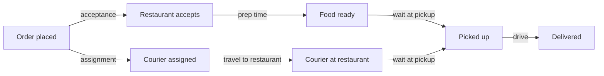

::interviewer 00:00
Average delivery time on a food delivery app rose from 30 to 38 minutes. Diagnose.

::candidate 00:05
Clarifying questions:
1. Over what period: suddenly or gradually?
2. All cities or specific ones?
3. Is "delivery time" from order placed to delivered?

::interviewer
Over the last 3 weeks, gradually. One large city. Order placed → delivered.

::candidate 00:20
Plan: validate → decompose delivery time into stages → find the stage that grew → segment → hypotheses → action.

**1. Validate:** any change in how timestamps are recorded (e.g. "delivered" now requires a photo, which happens later)? Are complaints about lateness also up?

::interviewer
Complaints are up. No tracking changes.

::candidate 00:35
**2. Decompose:**

Which stage grew?

::interviewer
Prep time and wait at pickup both grew. Drive time is flat.

::candidate 00:55
Couriers are waiting at restaurants because food isn't ready. So the problem is on the **restaurant side**.

**3. Segment:** by restaurant: is it spread across all restaurants, or concentrated in some? By cuisine, by time of day.

**Hypotheses:**
- **New popular restaurants** that are slow (e.g. a viral restaurant with long prep times).
- **Order volume increase** (promotion) overwhelming kitchens at peak.
- **Restaurant staffing shortages** (seasonal).
- **Batching changes:** couriers sent too early (dispatch algorithm change) so they wait longer.
- **Inaccurate prep time estimates** in our system after a change.

::interviewer
It's concentrated in about 50 restaurants that joined a big promotion 3 weeks ago.

::candidate 01:25
So: **a promotion drove order volume beyond those restaurants' kitchen capacity** at peak times, increasing prep times and courier waiting.

**Action:**
- **Short term:** throttle promotion visibility or order volume for those restaurants at peak times; adjust prep time estimates so couriers aren't dispatched too early; let restaurants pause orders when overwhelmed.
- **Medium term:** capacity-aware promotions (cap orders per hour based on historical capacity); give restaurants a "busy mode".
- **Measure:** delivery time and complaints for those restaurants; courier wait times; promotion ROI including lost customers due to lateness.

**Summary:** Delivery time grew because prep and pickup waits rose at ~50 restaurants overwhelmed by a promotion. Fix with capacity-aware promotions, better prep estimates and busy modes, and judge promotions on net impact including lateness.

::scorecard
- **Process decomposition** pinpointed the problem stages.
- **Narrowed to a specific segment** with data.
- **Fix balances growth (promotions) and operations.**
