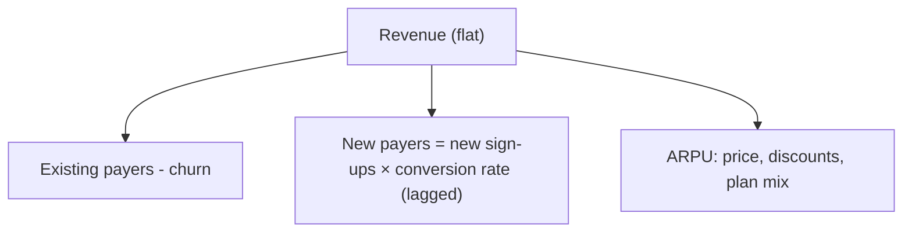

::interviewer 00:00
Sign-ups are up 30% month over month, but revenue is flat. What's going on?

::candidate 00:05
Clarifying questions:
1. What's the business model: freemium subscription, free trial, or transactional?
2. Typical time from sign-up to first payment?
3. Did anything change recently: marketing campaigns, pricing, the free tier?

::interviewer
Freemium subscription app (like a productivity tool). Most paying users convert within 60 days. Marketing launched a new influencer campaign last month.

::candidate 00:30
Plan: decompose revenue, then test hypotheses.

**Revenue = paying users × ARPU**, and paying users = existing payers − churned payers + new payers.

**Hypotheses:**
1. **Time lag:** sign-ups take up to 60 days to convert, so revenue from last month's sign-ups hasn't shown up yet.
2. **Lower-quality sign-ups:** the influencer campaign brought curious, low-intent users who won't convert.
3. **Churn of existing payers** offset new revenue.
4. **ARPU decline:** discounts in the campaign, or a shift to cheaper plans.
5. **Fake / bot sign-ups** inflating numbers.

::interviewer
How would you test these?

::candidate 01:10
- **Lag:** look at **cohort conversion curves**: compare day-14 and day-30 conversion of the new month's cohort with previous cohorts at the same age. If they're tracking similarly, revenue will come.
- **Quality:** split sign-ups by **acquisition channel**; compare activation (key action in week 1) and early conversion for the influencer channel vs others.
- **Churn:** check payer churn this month vs previous months.
- **ARPU:** check discount usage, plan mix, average price.
- **Bots:** look for suspicious patterns (same IPs, no activity after sign-up).

::interviewer
The influencer cohort's week-1 activation is half that of other channels. Churn is stable.

::candidate 01:40
So the most likely explanation is **(2) low-intent sign-ups from the influencer campaign**, possibly combined with **(1) time lag** for the rest.

**Implications and actions:**
- **Evaluate the campaign on conversion and CAC per paying user**, not sign-ups. Sign-ups are a vanity metric here.
- **Improve onboarding for this audience:** they may be younger or less familiar with the use case. Targeted onboarding might lift activation.
- **Rebalance marketing spend** toward channels with better activation and conversion.
- **Forecast:** project revenue from the cohort using its early conversion curve to set expectations.

**Summary:** Sign-ups grew because of an influencer campaign, but those users activate at half the normal rate, and conversions lag by up to 60 days, so revenue is flat. Judge channels on activation and cost per paying user, and improve onboarding for the new audience.

::scorecard
- **Revenue decomposition** with time lag considered.
- **Specific tests for each hypothesis.**
- **Shift from vanity metric to cost per paying user.**
