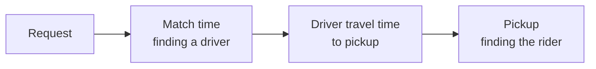

::interviewer 00:00
Uber ride wait times increased 20% in one city. What happened?

::candidate 00:05
Let me clarify first:
1. How is wait time defined: from request to driver assignment, or request to pickup?
2. Since when, and is it all day or specific hours?
3. Is it the whole city or specific areas?

::interviewer
Request to pickup. It started about 10 days ago. You'll need to find out more.

::candidate 00:20
My structure for a marketplace metric:
1. Validate the metric (is the calculation or data correct?)
2. Break wait time into its components
3. Supply vs demand vs matching
4. Segment (time, area, product)
5. Hypothesis → confirm → action

**1. Validate:** any change in how ETA or pickup time is calculated, a maps data update, or GPS issues on a new app version? Are related metrics consistent: are cancellations up too (riders give up when waits are long)?

::interviewer
Cancellations by riders are up too. No measurement changes.

::candidate 00:50
So it's real and hurting the experience.

**2. Components of wait time:**

Which component grew? Can I see match time vs travel time?

::interviewer
Match time is roughly flat. Travel time to pickup is up a lot.

::candidate 01:10
Interesting: drivers are found quickly but are **farther away** (or slower to arrive). That suggests either **fewer drivers nearby** (supply is thinner or in the wrong places) or **slower roads** (traffic, road closures).

**3. Supply / demand / matching hypotheses:**
- **Supply:** fewer online driver hours or drivers concentrated elsewhere (e.g. drivers chasing a competitor's bonus, airport queues, fuel costs, new regulation).
- **Demand:** more requests in certain areas or times (an event, a transit strike, weather) spreading drivers thin.
- **Roads/matching:** construction, road closures, a new traffic pattern, a dispatch algorithm change that matches over larger radiuses.

Can I see online driver hours vs last month, by time of day?

::interviewer
Driver hours are down about 15% in evenings. Daytime is flat.

::candidate 01:40
Evening supply is the main driver. Why would drivers go offline in the evenings?
- **Competitor incentives:** a rival launched an evening bonus.
- **Our own incentive change:** did we reduce evening incentives or change pricing recently?
- **Safety concerns** at night (incidents in the news).
- **Seasonal:** students (part-time drivers) on exams, or daylight savings change.
- **Regulation:** a new night-time licensing rule.

I'd check: our incentive changes log, driver surveys or support contacts, competitor activity reports, and whether the drop is concentrated among particular drivers (part-time vs full-time).

::interviewer
Our team reduced the evening bonus 2 weeks ago to save costs.

::candidate 02:05
That's likely the root cause: **lower evening incentives → fewer evening driver hours → drivers farther from riders → longer travel times → more cancellations**.

**Confirm:** compare evening hours among drivers who previously earned the bonus vs those who didn't; look at timing (drop began right after the change).

**Action options:**
1. Restore the bonus fully (fast fix, but cost).
2. **Targeted incentives:** only in the areas and hours where supply is thinnest (smarter cost).
3. Better use of surge pricing to attract drivers dynamically.
4. Longer-term: driver loyalty programmes (e.g. tiers with perks) that reduce dependence on bonuses.

**Trade-off:** savings from the bonus cut vs lost trips and riders churning after bad experiences. I'd quantify: trips lost × contribution margin + estimated rider churn cost vs bonus savings. Most likely the cut cost more than it saved.

**Summary:** Wait times rose because evening driver supply fell 15% after we reduced the evening bonus, so drivers were farther away. I'd test targeted incentives where supply is thinnest and compare their cost with the trips and riders we're losing.

::scorecard
- **Decomposed wait time into components**, which immediately narrowed the search.
- **Supply/demand/matching framework** for marketplaces.
- **Specific data requests** at each step.
- **Quantified trade-off** for the fix.
