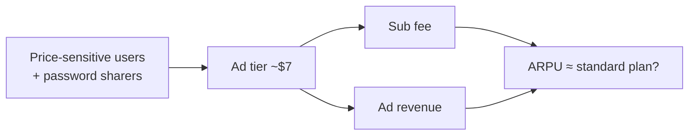

::interviewer 00:00
Was Netflix right to launch an ad-supported tier?

::candidate 00:05
Structure: (1) why Netflix did it (context), (2) the economic logic, (3) risks, (4) evidence and evaluation, (5) how I'd judge success.

::candidate 00:15
**1. Context (2022):** Netflix lost subscribers for the first time in a decade; growth slowed in mature markets; competitors (Disney+, Hulu, HBO Max, Peacock) offered cheaper ad tiers; widespread password sharing (Netflix estimated 100M+ households were sharing). Netflix had long resisted ads.

**2. Economic logic: price discrimination.**
- Not everyone values Netflix at $15+/month. A cheaper tier (~$7) captures **price-sensitive users** who would otherwise not subscribe or would share passwords.
- **Ad revenue + subscription fee** can match or exceed the revenue of a standard ad-free plan per user.
- It pairs with the **password-sharing crackdown**: people kicked off a shared account have a cheap legal option.
- Ads also open a **new revenue stream** that grows with engagement.

::interviewer
Wouldn't existing subscribers just downgrade to the cheaper tier?

::candidate 01:15
That's the main risk: cannibalization. Mitigations Netflix used or could use: making the ad tier noticeably different (ads, lower resolution or limited downloads), keeping ad loads moderate, and pricing so that ARPU of the ad tier is close to the standard tier. The key analysis is **incremental**: what share of ad-tier sign-ups are new or returning members vs downgrades? If most are new, it's clearly positive.

::candidate 01:45
**3. Risks:** cannibalization; brand perception (premium, ad-free); building ad tech and sales capability from scratch (initially partnered with Microsoft); advertisers needing measurement Netflix lacked at first.

**4. Evaluation:** Netflix reported strong growth of the ad tier in launched markets, with a large share of new sign-ups choosing it where available, and later said ad-tier membership grew to tens of millions of monthly active users. Combined with the password crackdown, subscriber growth reaccelerated.

**Verdict: yes, it was right.** It addressed a real segment (price-sensitive viewers), supported the password crackdown, and created a new long-term revenue stream, while keeping ad-free options for those who pay more.

**5. How I'd judge success:**
- Incremental subscribers (new + returning) vs downgrades.
- ARPU of the ad tier vs standard (target ≥ parity over time as ad pricing improves).
- Churn by tier; engagement by tier.
- Advertiser demand: fill rate, CPMs.
- **Guardrails:** satisfaction and churn among ad-tier users (ad load), brand perception.

::scorecard
- **Context → economic logic → risk → evidence → verdict**, a clean evaluation flow.
- **Cannibalization handled** with an incrementality lens.
- **Clear judgement** with success criteria.
