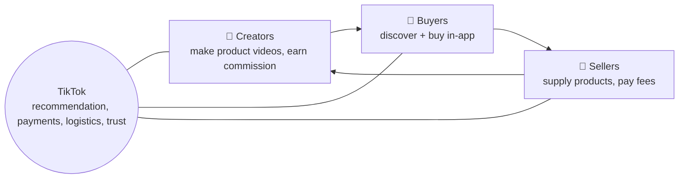

::interviewer 00:00
How should TikTok grow its e-commerce business?

::candidate 00:05
Clarifying questions:
1. Which market? TikTok Shop's maturity differs by country.
2. What's the objective: GMV growth, profitability, or user experience?
3. Any constraints (e.g. regulatory scrutiny)?

::interviewer
The US. Objective: grow GMV sustainably over 3 years. Assume regulatory scrutiny exists but focus on the business.

::candidate 00:30
**Objective:** grow GMV sustainably, meaning repeat buyers and trusted sellers, not just one-off impulse buys.

Structure: TikTok's advantage → barriers → three-sided ecosystem (buyers, sellers, creators) → strategy pillars → metrics and guardrails.

::candidate 00:50
**TikTok's advantage:** **discovery commerce.** Amazon serves people who already know what they want (search). TikTok creates demand: you see a product in action from a creator you trust, and buy on impulse. Huge engagement and a strong recommendation engine.

**Barriers:**
1. **Trust and quality:** cheap, low-quality or fake products; "TikTok made me buy it" disappointment.
2. **Fulfilment:** slow shipping compared with Amazon Prime.
3. **Repeat purchase:** impulse buying doesn't create habits.
4. **Feed balance:** too much shopping content could hurt the core entertainment experience.
5. **Seller and creator economics:** need fair commissions and tools.

::candidate 01:30
**Ecosystem:**

**Strategy pillars:**
1. **Trust first:** seller verification, quality standards, product reviews from verified buyers, easy returns, a buyer protection guarantee. Penalize sellers with high return or complaint rates.
2. **Fulfilment:** TikTok-managed fulfilment for top sellers, faster shipping promises (e.g. "arrives in 3 days" badge).
3. **Creator affiliate engine:** easy product tagging, transparent commissions, creator–seller matching marketplace, performance analytics.
4. **Live shopping:** grow live commerce events (popular in China's Douyin), with brands and creators.
5. **From impulse to repeat:** a shop tab, order history, "buy again", follow stores, personalized deals.

::interviewer
How do you avoid turning the For You feed into an ad catalogue?

::candidate 02:20
Treat shopping content like any other content: **rank it by engagement and satisfaction, not just commercial value**. Cap the share of shoppable videos per session, give users a dedicated Shop tab for intentional shopping, and watch guardrails: time spent, "not interested" rate on shoppable videos, user retention. If those degrade, reduce the share.

::candidate 02:45
**Prioritization:** trust (pillar 1) comes first, because without it GMV growth turns into returns, bad reviews and regulatory risk. Then fulfilment (2) and creators (3) as growth engines, then repeat-purchase features (5).

**Metrics:**
- **North Star:** GMV from repeat buyers (sustainable growth).
- Buyer: conversion rate from shoppable videos, repeat purchase rate in 90 days, return/complaint rate.
- Seller: active sellers, seller retention, on-time shipping.
- Creator: active affiliate creators, creator commission earnings.
- **Guardrails:** feed engagement and retention for non-shoppers, counterfeit reports, refund rates.

**Summary:** TikTok's strength is discovery commerce, but GMV only grows sustainably with trust, fast fulfilment, rewarding creators, and repeat buying. I'd lead with quality and buyer protection, then scale creators and live shopping, while protecting the entertainment feed with strict guardrails.

::scorecard
- **Clear competitive framing** (discovery vs search commerce).
- **Three-sided ecosystem** captured visually.
- **Feed guardrail** shows awareness of core-product cannibalization.
