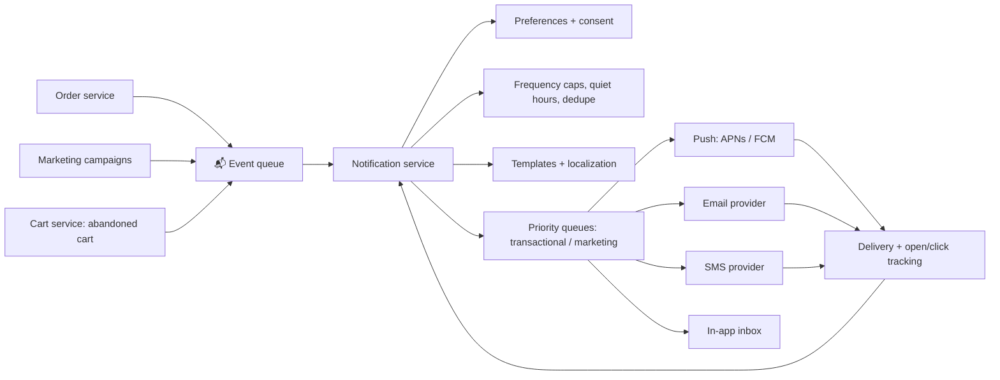

::interviewer 00:00
Design a notification system for a large app, at a high level.

::candidate 00:05
Clarifying questions:
1. What kind of app? Social, e-commerce, ride-sharing?
2. Which channels: push, email, SMS, in-app?
3. Types: transactional (order shipped, password reset) and marketing/engagement?
4. Scale?

::interviewer
An e-commerce app, all channels, both types. Tens of millions of users, peaks of millions of notifications per hour during sales events.

::candidate 00:25
Plan: requirements → architecture → key components (preferences, prioritization, rate limits, delivery) → reliability → product decisions and metrics.

**Requirements:**
- **Transactional** notifications (order confirmed, shipped, delivered, password reset) must be fast and reliable.
- **Marketing** notifications (deals, abandoned cart) must respect preferences, frequency caps and quiet hours.
- Handle spikes (Black Friday), multiple channels, localization, tracking.

::candidate 00:45
**Architecture:**

**Key components:**
1. **Event queue:** services publish events ("order shipped"); the queue absorbs spikes and decouples systems.
2. **Preferences and consent:** user choices per channel and category (e.g. "no marketing SMS"), plus legal requirements (opt-in for marketing email/SMS, unsubscribe links).
3. **Rules engine:** frequency caps (e.g. max 3 marketing pushes per week), quiet hours by time zone, deduplication (don't send "order shipped" twice), **batching** ("3 items in your wishlist are on sale" instead of 3 notifications).
4. **Priority queues:** transactional messages in a high-priority lane so a marketing blast never delays a password reset.
5. **Channel adapters:** integrate push services (Apple APNs, Google FCM), email and SMS providers; handle each provider's limits and errors.
6. **Tracking and feedback:** delivered/opened/clicked/unsubscribed feeds analytics and personalization (send at the time each user usually engages).

::interviewer
How would you handle reliability during Black Friday?

::candidate 01:50
- **Horizontal scaling** of notification workers based on queue depth.
- **Separate lanes:** transactional always prioritized; marketing can be throttled or delayed if the system is under load.
- **Retries with backoff** for provider errors, and **idempotency keys** so retries don't cause duplicates.
- **Multiple providers** for critical channels (e.g. two SMS providers) with automatic failover.
- **Load testing** before the event and staggered campaign sends (instead of everything at 9:00 sharp).

::candidate 02:15
**Product decisions:**
- **Relevance:** rank candidate marketing notifications by predicted value, and send only the best one rather than all.
- **User control:** easy settings per category; a way to snooze.
- **Value over volume:** measure the long-term effects of notifications.

**Metrics:** delivery latency for transactional messages (e.g. under 30 seconds), delivery success rate, open and click rates by type, conversion from notifications, **opt-out and uninstall rates** (guardrails), complaint and spam reports, and long-term holdout comparisons for marketing notifications.

**Summary:** an event-driven system where a central notification service applies preferences, consent, frequency caps and prioritization, then delivers through channel adapters with tracking, reliability via priority lanes, scaling, retries and failover, and product success measured by value delivered, not volume sent.

::scorecard
- **Requirements split** (transactional vs marketing) shapes the design.
- **Complete architecture** with a diagram.
- **Reliability depth:** idempotency, priority lanes, failover.
- **Product thinking:** relevance, user control, opt-out guardrails.
