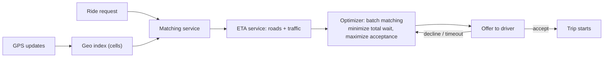

::interviewer 00:00
How does a ride-hailing app match riders and drivers?

::candidate 00:05
I'll explain the flow end to end: (1) tracking driver locations, (2) the rider request, (3) finding candidates, (4) estimating arrival times, (5) choosing the match, (6) the offer and acceptance, (7) pricing and metrics.

**1. Tracking driver locations.** Online drivers' apps send GPS updates every few seconds. With hundreds of thousands of drivers, that's a lot of writes, so locations are kept in fast in-memory storage and indexed **geographically**. A common approach divides the map into cells (e.g. hexagons, like Uber's open-source H3 system), so finding "drivers near this point" means checking a few nearby cells instead of every driver.

**2. Rider request.** The rider sets pickup and destination; the app sends the request with location to the matching service.

**3. Candidate drivers.** Look up drivers in the rider's cell and neighbouring cells, filtered by availability, vehicle type (UberX, XL), and sometimes driver preferences or destination filters.

::candidate 00:55
**4. Estimate arrival times (ETA).** Straight-line distance is misleading (rivers, one-way streets, traffic). An ETA service uses the road network, live traffic and historical patterns (often with ML) to estimate how long each candidate would take to reach the pickup.

**5. Choose the match.** Naively: pick the driver with the shortest ETA (greedy). Better: **batch matching** over a short window (a few seconds): consider all open requests and available drivers together and find the assignment that minimizes total wait across the city. Greedy matching can give rider A the closest driver, leaving rider B with a long wait, when a swap would have been better for both.

**6. Offer and acceptance.** The selected driver gets an offer with a short time to accept. If they decline or time out, the system offers to the next best driver. Acceptance likelihood can be factored into the choice.

::interviewer
How does pricing fit in?

::candidate 01:50
**Dynamic (surge) pricing** balances supply and demand by area and time. When requests in a zone exceed available drivers, prices rise, which reduces some demand and attracts drivers to the area. Upfront pricing tells riders the fare before booking, based on estimated route, time and demand. Matching and pricing work together to keep wait times reasonable.

**7. Metrics a PM would track:** match rate (requests fulfilled), pickup ETA and accuracy, driver acceptance rate, cancellation rates (rider and driver), driver utilization (time with a passenger), and time-to-match. Trade-offs: batch windows add a few seconds of delay but can improve overall efficiency.

**Summary:** drivers' GPS updates feed a geographic index; a request triggers a search for nearby drivers, road-network ETAs, and an optimizer (often batch matching) that minimizes overall wait; offers go to drivers with fallbacks, while dynamic pricing balances supply and demand.

::scorecard
- **End-to-end flow** with a diagram.
- **Technical nuance:** geospatial indexing, road-based ETA, batch vs greedy matching.
- **Pricing and metrics** tie it back to product.
