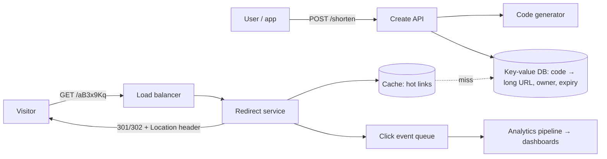

::interviewer 00:00
Design a URL shortener like bit.ly, at a high level.

::candidate 00:05
Before designing, let me clarify the requirements:
1. **Core features:** shorten a long URL, redirect from the short URL. Also custom aliases, expiration, click analytics?
2. **Scale:** how many new links per day and how many clicks (redirects)?
3. **Users:** anonymous public use, or logged-in businesses with dashboards?

::interviewer
Core features plus analytics. Assume 10 million new links per day and 1 billion redirects per day. Both anonymous and business users.

::candidate 00:25
That gives a **read-heavy** system: 1B redirects vs 10M creations = **100:1 read/write ratio**. Redirects must be very fast (users are waiting), and highly available (a broken short link breaks marketing campaigns).

Quick numbers: 1B/day ÷ 86,400 ≈ **~12,000 redirects per second** on average, maybe ~30–50k at peak. 10M links/day × 365 × 5 years ≈ 18B links stored.

Plan: API → short code generation → storage → redirect path with caching → analytics → abuse prevention → trade-offs.

::candidate 00:55
**Architecture:**

**1. Short code generation.** Use **base62** (a–z, A–Z, 0–9). 7 characters gives 62⁷ ≈ **3.5 trillion** codes, plenty for 18B links.
Options:
- **Counter + base62 encode:** unique and short, but needs a distributed counter (e.g. pre-allocated ranges per server so they don't collide).
- **Random code + collision check:** simple, unpredictable (harder to enumerate), but requires a database check on each creation.
I'd use **pre-allocated counter ranges** (fast, no collisions) and optionally shuffle so codes aren't sequential and guessable.

**2. Storage.** A simple mapping: code → long URL (+ owner, created date, expiry). Billions of rows, simple lookups, so a **distributed key-value / NoSQL store** fits well. ~18B × ~500 bytes ≈ 9 TB: manageable, partitioned (sharded) by code.

**3. Redirect path (the critical path).** Look up the code in the **cache** first (Redis/Memcached). Link popularity follows a power law: a small share of links get most clicks, so a cache hit rate of 90%+ is realistic. On a miss, read from the DB and populate the cache. Return an HTTP redirect.

::interviewer
301 or 302 redirect: which would you use and why?

::candidate 02:05
- **301 (permanent):** browsers and intermediaries can cache it, so repeat visits skip our servers. Faster and cheaper, but **we lose click tracking** for cached visits and can't change the destination later.
- **302 (temporary):** every click comes to us, so **analytics are complete** and links can be edited or expired.

Since analytics is a core product feature (and businesses pay for it), I'd use **302** by default, maybe offering 301 for users who don't need analytics.

**4. Analytics.** The redirect service publishes a click event (time, code, referrer, country from IP, device) to a **queue** asynchronously, so analytics never slows down redirects. A stream processing pipeline aggregates clicks into a database for dashboards.

**5. Abuse prevention.** Short links are used for phishing and malware. Check URLs against safe-browsing blocklists at creation, rate-limit anonymous creation, add a warning interstitial for suspicious links, and offer a "preview" feature (add "+" to see the destination).

**6. Reliability:** replicate data across regions; the redirect service is stateless and scales horizontally; serve from multiple regions for low latency.

**Product metrics:** redirect latency (p99 under ~50 ms), availability (99.99%), cache hit rate, links created, clicks per link, abuse rate, business conversion to paid analytics.

**Summary:** a read-heavy system where a stateless redirect service with heavy caching serves lookups from a sharded key-value store, base62 codes from pre-allocated counter ranges, 302 redirects to preserve analytics, asynchronous click logging, and abuse protection.

::scorecard
- **Requirements and scale estimates** drive the design (100:1 read/write).
- **Clear components** with a diagram.
- **Trade-offs explained** (code generation options, 301 vs 302) and tied to product value.
- **Abuse and metrics** included, which is the PM perspective.
