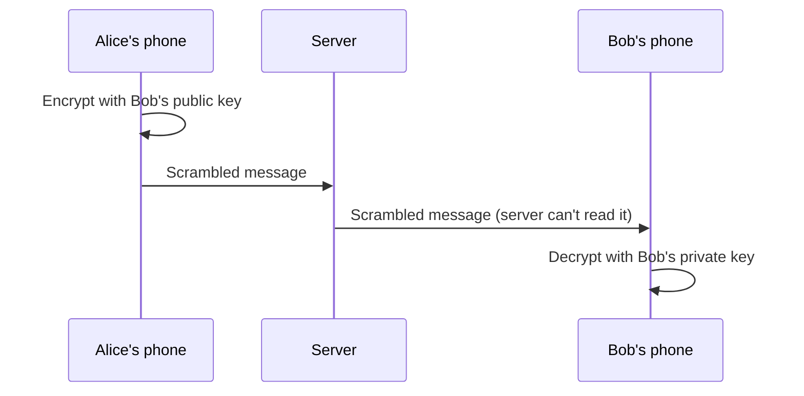

::interviewer 00:00
What is end-to-end encryption, and what product trade-offs does it create?

::candidate 00:05
I'll explain how it works simply, compare it with regular encryption, and then cover the product trade-offs and how companies handle them.

**What it is.** With **end-to-end encryption (E2EE)**, a message is encrypted on the sender's device and can only be decrypted on the recipient's device. The service in the middle (e.g. WhatsApp's servers) only sees scrambled data it **cannot read**, even if it wanted to or was hacked.

**How, simply:** each user has a pair of keys: a **public key** (shared openly, like a padlock anyone can close) and a **private key** (kept on their device, the only key that opens that padlock). Alice locks the message with Bob's public padlock; only Bob's private key can open it.

**Compared with encryption in transit** (standard HTTPS): data is encrypted between your device and the server, but the **server can read it** (e.g. regular email providers can scan email content). E2EE removes the provider's access.

::candidate 01:00
**Product trade-offs:**

| Area | Impact of E2EE |
|---|---|
| **Privacy & trust** | ✅ Strong selling point; protects against breaches and surveillance |
| **Content moderation / safety** | ❌ Server can't scan messages for spam, abuse, illegal content; must rely on user reports, metadata, on-device signals |
| **Features** | ❌ Harder: server-side search, AI features that read messages, link previews generated on servers, multi-device sync, cloud backups |
| **Account recovery** | ❌ Lose your keys (device) → can lose message history, unless encrypted backups exist |
| **Regulation** | ⚠️ Governments may pressure for "lawful access"; some countries restrict it |
| **Business** | ❌ Can't use message content for ads targeting (which is also a trust benefit) |

::interviewer
How do companies like WhatsApp handle safety without reading messages?

::candidate 01:40
Several approaches:
- **User reports:** when a user reports a message, the recent messages from that chat are sent to the platform for review (the reporter's device shares them).
- **Metadata and behavioural signals:** e.g. accounts sending many messages to strangers, new accounts mass-messaging, used to detect spam without reading content.
- **Forwarding limits:** WhatsApp limited how many chats a message can be forwarded to, slowing viral misinformation.
- **On-device features:** e.g. warnings for suspicious links processed on the device.
- **Encrypted backups** for recovery, with user-held keys or passwords.

**Summary:** E2EE means only the sender and recipient can read messages. It creates strong privacy and trust, but makes moderation, server-side features and account recovery harder, so companies use reports, metadata signals, friction (forward limits), and on-device processing to keep users safe.

::scorecard
- **Simple, accurate explanation** (public/private keys) with a diagram.
- **Clear contrast** with encryption in transit.
- **Comprehensive trade-off table** and realistic mitigations.
