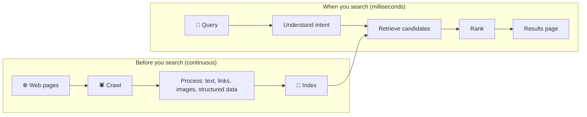

::interviewer 00:00
How does Google Search work, at a high level?

::candidate 00:05
I'll describe two parts: what happens **before** you search (crawling and indexing, done continuously), and what happens **when** you search (understanding, retrieval, ranking, serving). Then I'll touch on how quality is measured.

**1. Crawling.** Automated programs (crawlers, e.g. Googlebot) discover pages by following links and reading sitemaps. Popular or frequently changing sites (news) are crawled more often.

**2. Indexing.** Pages are processed: text extracted, language detected, links recorded, images and structured data understood, duplicates grouped. The core structure is an **inverted index**: like the index at the back of a book, it maps each word to the list of pages containing it, so lookups are extremely fast.

**3. Query understanding.** When you type a query, Google corrects spelling, expands synonyms, detects intent (are you looking for a website, an answer, a product, a place?), and uses language models to understand meaning, not just keywords. E.g. "can you get medicine for someone pharmacy" means picking up a prescription for someone else.

**4. Retrieval.** Using the index, it quickly finds thousands of candidate pages that could be relevant.

**5. Ranking.** Machine learning models score candidates on many signals:
- **Relevance** to the query's meaning
- **Quality and authority:** links from trusted sites (the original PageRank idea), expertise and trustworthiness
- **Freshness** for time-sensitive queries
- **Location and language** (e.g. "pizza" shows nearby places)
- **Page experience:** mobile-friendly, fast, secure

**6. Serving.** Results are assembled with features like snippets, maps, images, knowledge panels, and AI-generated overviews, returned in a fraction of a second from data centres around the world.

::interviewer
How would Google know if a ranking change made results better?

::candidate 01:35
Two layers:
- **Offline:** human **search quality raters** follow guidelines to rate results for sample queries; metrics like NDCG measure if better results rank higher.
- **Online (live experiments):** A/B tests on a small share of traffic measuring user behaviour: clicks on top results, **"good abandonment"** (the answer was on the page, so no click needed), **query reformulation** (rephrasing suggests failure), time to a successful click, and "long clicks" (users stay on the page, a sign of satisfaction).

A change typically ships only if both offline ratings and online metrics improve.

**Summary:** Google continuously crawls and indexes the web into an inverted index; at query time it understands intent, retrieves candidates, ranks them with ML using relevance, quality, freshness and context signals, and serves rich results in milliseconds, with quality validated by human raters and live experiments.

::scorecard
- **Clear two-phase model** (before and during search) with a diagram.
- **Accurate concepts** (inverted index, PageRank, intent).
- **Strong follow-up** on evaluation (raters + live metrics like reformulation and good abandonment).
