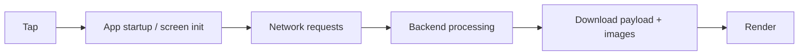

::interviewer 00:00
Your app's screens load slowly. How would you work with engineering to improve it?

::candidate 00:05
Clarifying questions:
1. Mobile app, web, or both?
2. All screens or specific ones?
3. How do we know it's slow: user complaints, metrics, or competitors?

::interviewer
Mobile app. Users complain the home feed and product pages are slow. We don't have great metrics yet.

::candidate 00:20
Plan: (1) measure, (2) connect to business impact, (3) diagnose bottlenecks, (4) prioritize fixes, (5) prevent regressions.

**1. Measure first.** Without data we'd guess. I'd work with engineering to add **real-user monitoring**:
- Time to first content and time to fully interactive for each key screen.
- **Percentiles** (p50, p90, p95), not averages: slow experiences hide in the tail.
- Broken down by **device type, OS, network (4G/Wi-Fi), country, app version**.

**2. Connect to business impact.** Analyse how load time correlates with conversion and engagement, e.g. "users with home feed load over 3 s browse 20% fewer products". Better yet, run a small experiment (artificially adding delay is sometimes done by large companies, though carefully). This turns speed from an "engineering nice-to-have" into a **business priority** for roadmap decisions.

::candidate 01:05
**3. Diagnose:** break the load time into parts:

Common culprits:
- **Too many network calls** in sequence (waterfalls).
- **Large payloads** (sending data the screen doesn't need).
- **Slow backend queries**, no caching.
- **Unoptimized images** (huge files on mobile networks).
- **Heavy rendering** on low-end Android devices.

::interviewer
Suppose the data shows the problem is worst on low-end Android devices in emerging markets.

::candidate 01:30
Then I'd focus there:
- **Smaller images** in modern formats sized for the device; lazy-load images below the fold.
- **Lighter payloads** and fewer API calls (e.g. a single aggregated endpoint for the home feed).
- **Caching** on the device: show cached content immediately, then refresh ("stale-while-revalidate").
- **Skeleton screens** to improve perceived speed.
- Possibly a **lite mode** for slow networks.
- Test on real low-end devices, not just engineers' flagship phones.

**4. Prioritize fixes** by impact × effort with engineering: quick wins first (image compression, caching), then structural fixes (API aggregation).

**5. Prevent regressions:**
- A **performance budget** (e.g. home feed p90 under 2 s on mid-range Android).
- Automated performance tests in CI and dashboards with alerts.
- Performance as a launch criterion for new features.

**Measure success:** p90 load time on key screens, conversion and engagement changes (A/B where possible), crash and ANR rates, app ratings mentioning speed.

**Summary:** measure real-user load times by segment, link them to business metrics, diagnose bottlenecks with engineering, fix the biggest ones for the most affected users (here, low-end Android), and lock in gains with performance budgets and monitoring.

::scorecard
- **Measure before acting** (percentiles, segments).
- **Business case** for performance work.
- **Targeted fixes** for the affected segment.
- **Prevention** via budgets and CI.
