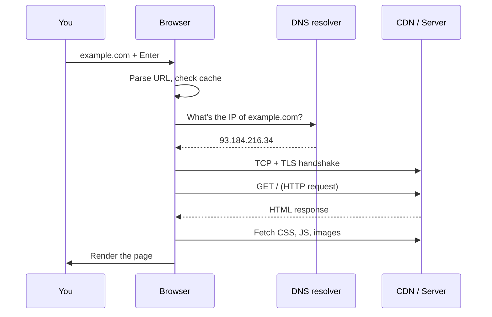

::interviewer 00:00
What happens when you type a URL into a browser and press Enter?

::candidate 00:05
Happy to walk through it. How deep would you like me to go? I can give a high-level overview of each step and then go deeper on whichever part interests you.

::interviewer
Start high-level, I'll ask follow-ups.

::candidate 00:15
I'll go step by step: **URL → DNS → connection → request → server → response → rendering**, and finish with why it matters for product.

**1. Parse the URL and check caches.** The browser decides if it's a URL or a search term. It checks its cache: if it has a recent copy of the page or resources, it may skip some steps.

**2. DNS lookup.** Computers communicate with IP addresses, not names. The browser asks for the IP address of the domain: browser cache → operating system cache → router → the internet provider's DNS resolver. If the resolver doesn't know, it asks the **root servers** → the **.com servers** → the domain's **authoritative server**, which answers with the IP.

**3. Establish a connection.** A **TCP handshake** sets up a reliable connection; for HTTPS, a **TLS handshake** agrees on encryption and verifies the site's **certificate** (proving it's really example.com). Often the server we connect to is a **CDN edge server** geographically close to us.

**4. HTTP request.** The browser sends something like `GET /` with headers (cookies, language, browser type).

**5. Server side.** A **load balancer** routes the request to an application server, which may read from a **cache** or **database**, then builds the response (HTML, or JSON for apps).

**6. Response and rendering.** The browser receives the HTML, parses it into the **DOM**, discovers additional resources (CSS, JavaScript, images, often from a CDN), downloads them, builds the layout, paints pixels, and runs JavaScript, which might fetch more data.

::interviewer
Why does a CDN make things faster?

::candidate 01:40
Because of **distance and load**. Data travels at a finite speed: a round trip from Europe to a US server can take ~80–100 ms, and loading a page requires many round trips. A CDN stores copies of static content (images, videos, scripts) on servers around the world, so users fetch them from a nearby location, sometimes just a few milliseconds away. It also reduces load on the origin servers and absorbs traffic spikes.

::interviewer
How would you, as a PM, use this knowledge?

::candidate 01:55
Page speed directly affects business metrics: studies from Google and others have shown that slower pages increase bounce rates and reduce conversion, and speed affects search ranking. Knowing the steps helps me work with engineering on the right levers:
- **CDN** for static assets, **caching** where data doesn't need to be real-time.
- **Fewer and smaller requests** (compress images, lazy-load below-the-fold content).
- **Measure** with real-user metrics (time to first byte, largest contentful paint) by region and device.
- Set a **performance budget** for new features, so we don't slowly make the site slower.

**Summary:** the browser resolves the domain via DNS, connects securely via TCP and TLS (often to a nearby CDN), requests the page, the server builds a response, and the browser parses and renders it, fetching more resources. Each step adds latency, which is why CDNs, caching and lean pages matter for conversion.

::scorecard
- **Clear, ordered explanation** with a diagram.
- **Correct technical depth** (DNS hierarchy, TLS certificates, DOM).
- **Follow-up depth** on CDNs with latency reasoning.
- **Product implications** (speed → conversion, performance budget).
