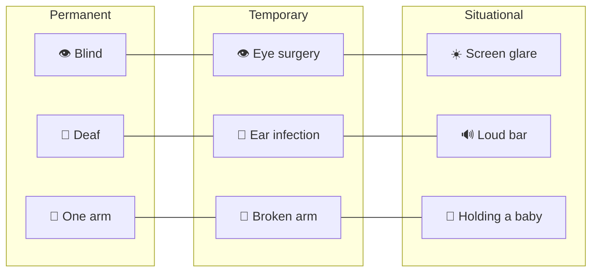

# ♿ Accessibility & inclusive design

> **In one line:** design for the edges and you improve the product for everyone (the "curb-cut effect").

The **persona spectrum**: a feature built for a permanent disability also helps people with temporary and situational limits. Captions were made for deaf users, and they're also used by millions of people watching on mute.

## The four principles (POUR)

<IconCards items={[
  {icon: '👀', title: 'Perceivable', text: 'Alt text, captions, sufficient colour contrast, no colour-only cues.'},
  {icon: '🖐️', title: 'Operable', text: 'Keyboard and voice navigation, large tap targets, no time traps.'},
  {icon: '🧠', title: 'Understandable', text: 'Plain language, predictable UI, clear error messages.'},
  {icon: '🔧', title: 'Robust', text: 'Works with screen readers and assistive tech across devices.'},
]} />

## In an interview
"Design X for blind / elderly / kids" questions test **empathy**. Show you understand the user's daily reality: what their workarounds are and what they're afraid of. Don't just bolt on voice control. Mention multi-sensory feedback (haptic, audio), caregiver involvement, and trust.

<Quiz question="What is the 'curb-cut effect'?" options={["Cutting features to save cost", "Accessibility features end up benefiting everyone", "Designing only for power users", "A pricing tactic"]} answer={1} explain="Curb cuts were built for wheelchairs and help strollers, bikes and luggage too." />

<UsedBy concept="accessibility" />
