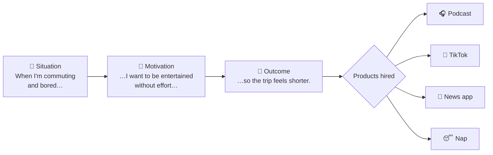

# 🧰 Jobs to be done (JTBD)

> **In one line:** people don't buy products, they "hire" them to make progress in a specific situation.

## Why it matters
The classic example is milkshakes. A fast-food chain found that many were bought **early in the morning by commuters**. The job was "make my boring drive interesting and keep me full until lunch." The milkshake's real competitors were bananas, bagels and boredom, not other milkshakes.

**JTBD widens your view of the competition and sharpens your view of the need.**

## The job story template

> **When** [situation], **I want to** [motivation], **so I can** [expected outcome].

| Job dimension | Question to ask | Example: buying a drill |
|---|---|---|
| Functional | What task needs doing? | Hang a shelf |
| Emotional | How do they want to feel? | Capable, not dependent on others |
| Social | How do they want to be seen? | As a handy homeowner |

## In an interview
- In **product design**, describe the user need as a job story. It sounds far more insightful than "users want feature X."
- In **strategy**, use jobs to find non-obvious competitors ("Netflix competes with sleep").
- In **improvement** questions, ask: "What job is this user hiring the product for, and where does it underdeliver?"

:::warning Common mistakes
- Writing a *feature* as a job ("I want a filter button").
- Making the job too broad ("I want to be happy").
:::

<Quiz question="Which is a well-formed job story?" options={["As a user I want dark mode", "When I'm reading in bed at night, I want the screen not to strain my eyes, so I can fall asleep easily", "Users want a better app", "I want more features"]} answer={1} explain="It names a situation, a motivation and an outcome, and doesn't prescribe a solution." />

<UsedBy concept="jobs-to-be-done" />
