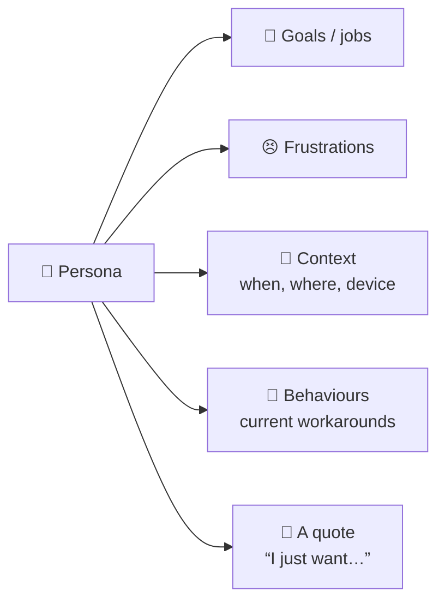

# 🧑‍🎨 Personas

> **In one line:** a short, concrete portrait of a representative user that makes a segment feel real.

<IconCards cols={3} items={[
  {icon: '👩‍💼', title: 'Priya, 34: Busy parent', text: 'Works full time, 2 kids. Job: get healthy dinners on the table in 20 minutes. Pain: decision fatigue at 6pm.', color: '#ec4899'},
  {icon: '🧑‍🎓', title: 'Leo, 21: Student', text: 'Small budget, small kitchen. Job: eat cheaply without the same pasta every night. Pain: cost and limited skills.', color: '#0ea5e9'},
  {icon: '👴', title: 'Ray, 70: Retiree', text: 'Cooks for one. Job: stay healthy on a medical diet. Pain: small portions, reading tiny text.', color: '#10b981'},
]} />

## Anatomy of a useful persona

## In an interview
After segmenting, give your chosen segment a **name and one-line story**: "Let's call her Priya, a working parent who has 20 minutes to cook." It makes your answer memorable and keeps you focused when you brainstorm solutions.

:::warning Common mistakes
- Personas full of irrelevant details (favourite colour) and missing goals and pains.
- Making the persona an idealized version of yourself.
:::

<Quiz question="What makes a persona useful for decisions?" options={["Detailed demographics", "Clear goals, pains and context", "A stock photo", "Many personas for every type of user"]} answer={1} explain="Goals, pains and context are what drive design choices." />

<UsedBy concept="personas" />
