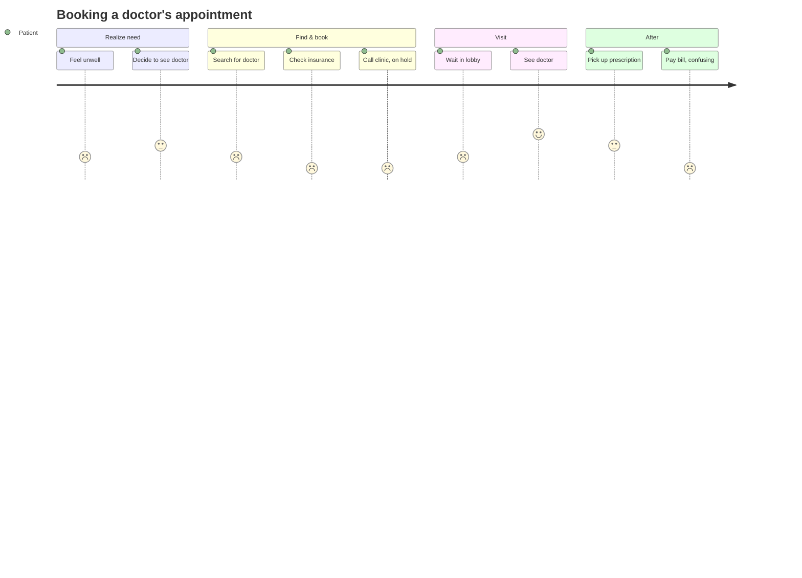
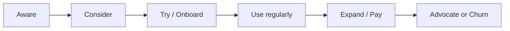

# 🧭 User journey mapping

> **In one line:** walk through every step a user takes to get their job done and mark where it hurts.

The lowest scores (insurance check, phone booking, billing) are your **opportunity areas**.

## Typical stages

## In an interview
In the "Report needs" step of [CIRCLES](/docs/frameworks/circles), say: "Let me walk through her journey…" and list 4–6 steps out loud. Pain points then come up *naturally*, and they're more credible than a random list.

:::tip
Look for the **moments of truth**: the first experience, the first failure, and the moment money changes hands. They shape retention more than anything else.
:::

<Quiz question="Why map the journey before listing pain points?" options={["It takes up time", "Pain points come from real steps, so they're specific and complete", "Interviewers require it", "It helps with pricing"]} answer={1} explain="A journey grounds your needs in actual user behaviour instead of guesses." />

<UsedBy concept="user-journey-mapping" />
