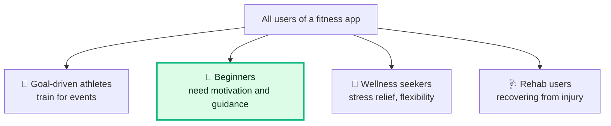
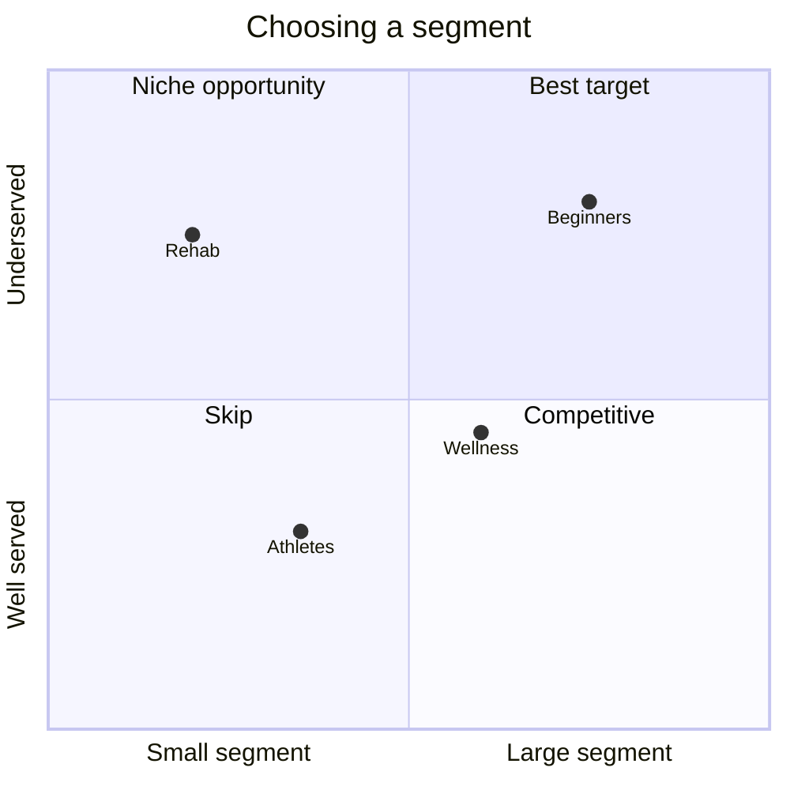

# 🧩 User segmentation

> **In one line:** split users into groups with **different needs or behaviours**, then focus on one.

## Ways to segment (best → weakest)

| Basis | Example | When to use |
|---|---|---|
| **Needs / jobs** | "wants to save money" vs "wants convenience" | Product design. Usually the best choice. |
| **Behaviour** | power users vs casual users, frequency | Improvement and metrics questions |
| **Lifecycle stage** | new, activated, dormant, churned | Retention and growth |
| **Context** | at home vs on the go | Mobile and IoT products |
| **Demographics** | age, income | Only when it actually predicts different needs |

## Picking ONE segment
Choose based on:

1. **Size**: is it big enough to matter?
2. **Pain**: how underserved is it today?
3. **Fit**: does it match the company's goal and strengths?
4. **Reach**: can we actually get to these users?

:::tip Say the trade-off
"I'll focus on beginners because they're the largest segment and churn the most, which matters given our retention goal. Athletes are attractive too, but they're well served by existing tools."
:::

<Quiz question="Which segmentation is usually MOST useful for product design?" options={["Age bands", "Needs/jobs-based", "Country", "Device type"]} answer={1} explain="Different needs lead to different solutions. Demographics often don't." />

<UsedBy concept="user-segmentation" />
