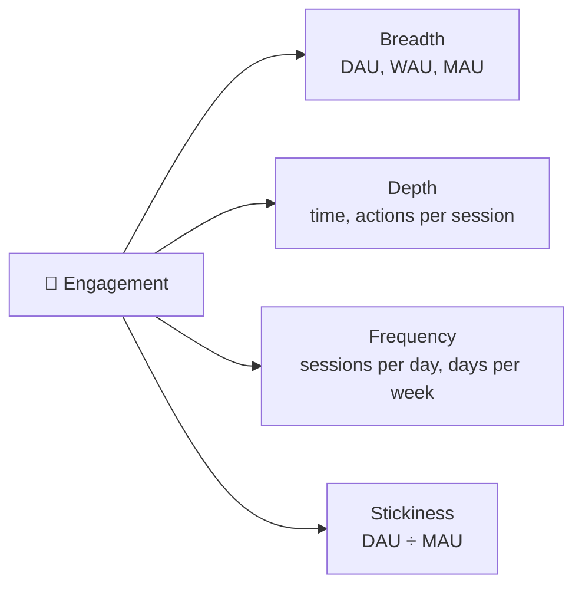
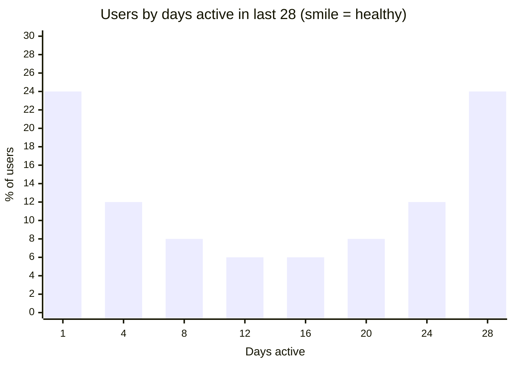

# 💓 Engagement metrics

> **In one line:** engagement measures how deeply and how often users use the product. Breadth × depth × frequency.

## Key formulas

| Metric | Formula | Benchmark |
|---|---|---|
| **DAU/MAU (stickiness)** | daily actives ÷ monthly actives | 20% is good; 50%+ is world-class (messaging apps) |
| **L7 / L28** | number of days active in the last 7 or 28 days | Histogram shows power users vs casual users |
| **Sessions per user** | sessions ÷ active users | Depends on the product |
| **Core action rate** | % of actives doing the *key* action | Better than generic "active" |

## The "power user curve" (L28 histogram)

A "smile" shape means a strong cohort of daily power users. A curve that only slopes down from left to right means most people are casual.

:::warning Define "active" carefully
"Opened the app" is weak. Better: **performed a meaningful action**, such as sent a message, completed a lesson, or watched for 30 seconds or more. Otherwise push notifications can inflate DAU.
:::

<Quiz question="DAU 2M, MAU 10M. Stickiness is…" options={["5%", "20%", "50%", "500%"]} answer={1} explain="2M ÷ 10M = 20%. The average user is active about 6 days a month." />

<UsedBy concept="engagement-metrics" />
